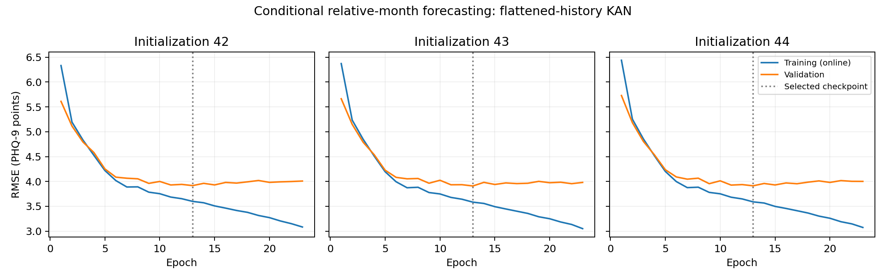
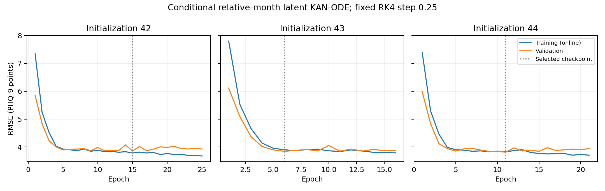

# Complete research project handover

**Evidence snapshot: 2026-10-19. Latest completed experiment: 2026-10-18.**

This is a context-transfer document for another assistant. It describes actual repository code and saved experiment records, distinguishes historical decisions from current ones, and identifies assumptions that remain unresolved. It is not a new experiment, model-selection decision, clinical validation, or authorization to open reserved outcomes. No training, calibration/test evaluation, commit, or push was performed to prepare it.

Read this document together with the reports it links. Paths are relative to repository root unless absolute. Private paths identify files to preserve, not files published on GitHub. Numerical tables preserve saved values where generated directly from JSON; concise comparisons round to six decimals. Original JSON remains authoritative for machine precision. **NOT VERIFIED** means the available evidence does not establish a fact.

## 1. Project objective and current scope

The user's current research title is **“Longitudinal, Causally-Informed Multitask Digital Phenotyping with Uncertainty-Aware KAN Foundation Models.”**

| Research question | Intended question | Actual status |
|---|---|---|
| RQ1 | Can KAN-ODE predict future depression/anxiety severity or worsening more accurately or earlier than conventional models? | Depression severity only: conditional relative-month development/validation experiments completed. No anxiety, worsening-classification, earlier-horizon performance comparison, prospective validation, or forecasting test evaluation. |
| RQ2 | Which behavioral/physiological factors relate to worsening, and can causal relationships be investigated under explicit assumptions? | Retrospective association/permutation/edge analyses and forecasting feature ablations exist. No causal identification or estimation method implemented. |
| RQ3 | Can conformal prediction provide reliable uncertainty overall and across demographic groups? | Separate forecasting calibration/test assignments and payloads exist. No conformal estimator, intervals, coverage evaluation, or subgroup reliability analysis implemented. |

The longer-term sequence is paper-inspired KAN → future forecasting → KAN-ODE → controlled RQ1 experiments → RQ2 causal analysis → RQ3 conformal/subgroup work. The repeatedly enforced shorter implementation sequence was **KAN → validated future forecasting → KAN-ODE → conformal prediction**. The forecasting stage remains explicitly conditional; later authorization permitted ODE experiments under those limitations. That did not resolve prospective timing.

“Foundation models,” dataset independence, smartphone streams, anxiety, and future GLOBEM/RADAR-MDD/All of Us use are research aspirations, not demonstrated capabilities. One user-uploaded PSYCHE-D export has actually been analyzed. Do not silently change datasets or outcomes. Reuse generic models/numerics/training where appropriate, but the current forecasting builder is PSYCHE-D-specific.

## 2. Conversation and decision history

The following is the recoverable research history, rather than a verbatim transcript. Original instructions and subsequent reports were inspected; missing execution details are marked instead of reconstructed.

| Stage | Decision/work | Why and current consequence |
|---|---|---|
| Original implementation request | Adapt Interpretable-MTLNet for **depression only**; audit supplied PSYCHE-D data first; do not access restricted All of Us; no anxiety, causal, ODE, or conformal implementation in that initial step. | The original paper's binary multitask/daily-data design could not simply be copied onto this export. Later anxiety/multitask/causal framing is an expansion of research intent, not proof of completed implementation. |
| Environment/data intake | Set up a CPU Python environment, inspect file content rather than trust extension, audit feature dictionary and targets. | A ZIP contained CSV despite a Parquet-like filename. Repeated uploads/alternative names do not establish experiments on several datasets. |
| Initial data decision | Prefixes treated as provisional groups; suffix timing unverified; user explicitly lacked confirming documentation. | No fabricated month timestamps, daily interpolation, or unrestricted forecasting helper. |
| Initial real-data experiment | Fit tabular KAN and conventional baselines for retrospective `phq9_score_end - phq9_score_start`. | This could use labeled exported rows without certifying a future cutoff. Continuous regression replaced unjustified binary labels/focal loss/AUROC. These results remain preserved and separate. |
| Temporal feasibility, first review | Future forecasting blocked. | Numerical order and endpoint continuity alone were insufficient evidence of index semantics or available-at timing. |
| Temporal feasibility, paper update | Supplied accepted PSYCHE-D and earlier SSRN papers, official source code, and aggregate CSV checks supported **conditional relative-month** mapping. | Revised decision: conditionally supported, not operationally verified. Original strict helper stayed guarded. |
| Separate forecasting builder | Require measured SM0/SM3 endpoints plus both SM1/SM2 history rows; target SM3 severity; cutoff SM2; one relative interval. | No target-change substitution, missing-target imputation, cross-participant joins, cross-quarter histories, or SM3 sensing inputs. |
| Simple forecasting baselines | Persistence, training mean, Ridge; fixed alpha grid selected on validation. | Establish whether no change and baseline severity/demographics are hard to beat. |
| Forecasting tabular KAN | Fixed 159→64→1 spline KAN, seeds 42/43/44; sanity check then full training. | Same saved features/cohort/preprocessing as Ridge, no tuning search. |
| Ridge A–D ablations | SM0; +demographics; +SM2; +SM1/SM2. | Isolate descriptive predictive increments without rebuilding the cohort. D reproduced previous Ridge exactly. |
| Non-ODE sequential control | Static KAN initializes width-16 state; shared packet KAN and conventional GRU process SM1 then SM2; KAN scalar head. | A small observation-by-observation control, not the source paper's multi-scale convolution. Original runs had no gradient clipping. |
| Latent KAN-ODE implementation | Add autonomous KAN vector field and fixed RK4 integrations before/between/after the two observation updates. | Paper-informed adaptation to two relative study-month packets; independent numerical tests, overfit check, then a deliberately short smoke run. |
| Full KAN-ODE | Fresh three-seed full training with clip norm 5, fixed step 0.25, endpoint MSE and validation selection. | No tuning in response to smoke RMSE. Actual clipping mismatch with original recurrent control disclosed. |
| Matched recurrent control | Retrain unchanged recurrent model with clip norm 5 and exactly matching shared initial tensors/minibatch order. | Removes that optimization mismatch while retaining the old unclipped experiment. ODE still has 3,088 extra parameters. |
| MLP dynamics control | Replace only KAN vector field with 16→93→16 Tanh MLP; leave KAN encoders, GRU, head, schedule, optimization unchanged. | Approximately match dynamics parameter counts (3,085 vs 3,088). Shared initialization matches, but vector-field function-space initialization does not. |
| Publication requests | Earlier work was pushed; five later logical commits exist locally. | A request to commit is not evidence of pushing. Live remote verification establishes the exact publication boundary in section 3. |
| Current request | Produce comprehensive handover only. | No new model or evaluation, no unlocking of held-out partitions. |

Approaches not adopted: automatic depression diagnosis thresholds; generated intermediate PHQ categories as labels; treating suffixes as calendar months; 30/60-day horizon claims; admitting undocumented regression features simply because their rows are earlier; including SM3 LMC/wearables; forcing reverse-packet performance to worsen; searching KAN/ODE architecture or solver settings using validation; treating feature importance as causality; claiming the original paper was exactly replicated.

Tasks still incomplete: verified as-of feature timing/export certificate, real-data temporal-convolution study, anxiety/multitask training, new-dataset adapters, forecasting held-out test, causal analysis, conformal calibration, demographic coverage evaluation, and external/prospective validation. No XGBoost/LightGBM experiment was executed by this project; those names occur in PSYCHE-D source-paper descriptions.

## 3. Repository, publication boundary, and environment

Repository: [MAYANK-RATHVA05/uncertainty-aware-kan-phenotyping](https://github.com/MAYANK-RATHVA05/uncertainty-aware-kan-phenotyping).

| Item | Verified state at this review |
|---|---|
| Local checkout | `/workspace/uncertainty-aware-kan-phenotyping` |
| Current branch | `work` |
| Local HEAD | `cc58ebb19db441b33aeea2b58b9946e30b45c6e2` |
| Accessible remote `main` | `d1dd783182ddd946ac6727d2a43286be274da45a` |
| Remote verification | Read-only `git ls-remote --heads origin` succeeded; only `main` was returned. |
| Local difference from remote | Five commits ahead, zero behind, checked against the above remote SHA. |
| Working tree before handover | Clean; 198 tracked files. |
| New work from this request | This handover is a new uncommitted local document. Nothing was committed or pushed during this review. |

The five locally committed, **unpushed** changes, in order:

| Commit | Subject |
|---|---|
| `054659c` | Add conditional KAN-encoded recurrent forecasting baseline |
| `f1aa669` | Implement latent KAN-ODE with verified RK4 and smoke checks |
| `a20a348d44fc8ddc47c851a00ced1e7158d84765` | Train and validate fixed three-seed latent KAN-ODE forecasts |
| `eacf0dc` | Add optimization-matched clipped recurrent control |
| `cc58ebb19db441b33aeea2b58b9946e30b45c6e2` | Add parameter-matched MLP latent dynamics ODE control |

**Implemented and pushed:** retrospective pipeline/models/tests/reports, conditional temporal audit and builder, forecasting baselines, tabular KAN, feature ablations, and initial sanitized aggregate results.

**Implemented but not pushed:** recurrent forecasting model, RK4 solver, KAN-ODE smoke/full experiments, matched recurrent and MLP dynamics controls, associated source/tests/docs, and sanitized recurrent/ODE extension results.

Verified remote links, pinned to what is actually accessible:

- [Source paper audit](https://github.com/MAYANK-RATHVA05/uncertainty-aware-kan-phenotyping/blob/d1dd783182ddd946ac6727d2a43286be274da45a/docs/paper_audit.md)
- [Temporal feasibility](https://github.com/MAYANK-RATHVA05/uncertainty-aware-kan-phenotyping/blob/d1dd783182ddd946ac6727d2a43286be274da45a/docs/temporal_feasibility.md)
- [Forecasting dataset](https://github.com/MAYANK-RATHVA05/uncertainty-aware-kan-phenotyping/blob/d1dd783182ddd946ac6727d2a43286be274da45a/docs/forecasting_dataset.md)
- [Forecasting baseline report](https://github.com/MAYANK-RATHVA05/uncertainty-aware-kan-phenotyping/blob/d1dd783182ddd946ac6727d2a43286be274da45a/docs/forecasting_baselines.md)
- [Tabular KAN report](https://github.com/MAYANK-RATHVA05/uncertainty-aware-kan-phenotyping/blob/d1dd783182ddd946ac6727d2a43286be274da45a/docs/forecasting_kan.md)
- [Feature ablation report](https://github.com/MAYANK-RATHVA05/uncertainty-aware-kan-phenotyping/blob/d1dd783182ddd946ac6727d2a43286be274da45a/docs/forecasting_feature_ablations.md)
- [KAN layer](https://github.com/MAYANK-RATHVA05/uncertainty-aware-kan-phenotyping/blob/d1dd783182ddd946ac6727d2a43286be274da45a/src/kan_phenotyping/models/kan_layer.py)
- [Conditional builder](https://github.com/MAYANK-RATHVA05/uncertainty-aware-kan-phenotyping/blob/d1dd783182ddd946ac6727d2a43286be274da45a/src/kan_phenotyping/data/conditional_forecasting.py)
- [Pushed aggregate results](https://github.com/MAYANK-RATHVA05/uncertainty-aware-kan-phenotyping/tree/d1dd783182ddd946ac6727d2a43286be274da45a/results/conditional_forecasting)

Do not give GitHub links for the later files as if they were published. The root [README](../README.md) predates ODE work and still describes ODE as unimplemented. That statement is stale. Conformal remains unimplemented. Likewise, a chronological report's “no ODE implemented” or “no commit performed” describes its own step, not the final state.

### Environment actually used

Python `3.12.14`; CPU PyTorch `2.9.1+cpu`; NumPy `2.3.5`; pandas `2.2.3`; pyarrow `22.0.0`; scikit-learn `1.8.0`; SciPy `1.17.0`; matplotlib `3.10.8`; PyYAML `6.0.3`; pytest `8.4.2`. Python requirement is `>=3.12,<3.13`. Recorded uv version is `0.12.23`. CUDA was unavailable; neural experiments used CPU, float32, two PyTorch threads, deterministic algorithms. Exact CPU model, peak RAM, and GPU memory utilization: **NOT VERIFIED**; no actual GPU OOM was recorded.

Environment is `/workspace/.venvs/uncertainty-aware-kan-phenotyping`. `scripts/setup_environment.sh` creates/reuses it, installs the official CPU Torch requirements and pinned dependencies, installs this package editable without re-resolving dependencies/build isolation, then checks imports/dependency compatibility. Workspace cache paths avoid read-only home locations. TLS/artifact verification was preserved. The setup was run and rerun successfully earlier.

An onboarding configuration draft saved installation/start instructions earlier. Publication of a reusable environment snapshot and validation in a fresh cloud instance are **NOT VERIFIED**. No server or special local-workflow credential is needed. A Git clone does not recover ignored research data/checkpoints.

## 4. Data, provenance, timing, and preprocessing

### 4.1 Actual dataset and original documentation

Only the supplied PSYCHE-D export was used in real-data experiments. Source project: [Evidation PSYCHE-D](https://github.com/evidation-opensource/PSYCHE-D/tree/444d3a6594988c6730a1cb5d24f2bdb8d1a971ba). This review does not certify a public download URL for the exact uploaded export. Original access terms and an authenticated Parquet→CSV export manifest are **NOT VERIFIED**.

| Item | Actual value |
|---|---|
| Raw usable file | `/workspace/private-data/psyche-d/anon_processed_df_parquet.csv` |
| Dictionary | `/workspace/private-data/psyche-d/feature_explanations.tsv` |
| Format | CSV extracted from uploaded ZIP, not Parquet |
| CSV bytes / ZIP bytes | 61,016,817 / 24,974,557 |
| CSV SHA-256 | `3d96afaa768bcd50c56524b931ac2e6acdd5f08c95db16c1e3b13d7dd6ce3934` |
| Dictionary SHA-256 | `e346b57eb81c8c7d22a6ff0bda71214e527d8bed72eef1c2218d7e5826612e3e` |
| Dimensions | 35,694 rows × 155 columns |
| Dictionary coverage | 154 named fields; only `__index_level_0__` is undocumented there |
| Missing cells | 861,072; missing values distinct from nonfinite invalid numeric observations |
| Composite keys | 35,694 unique; 4,948 distinct prefixes; observed suffixes 1–12 |
| Endpoint rows | 10,866 measured start/end pairs from 4,036 prefixes, suffixes 3/6/9/12 |
| Outcome fields | `phq9_score_start`, `phq9_score_end`, `phq9_cat_start`, `phq9_cat_end` |
| Scores | Observed integers 0–27; categories 0–4; all four missing in 24,828 intermediate rows |
| Dictionary categories | 65 sleep, 46 steps, 39 demographic, 4 PHQ |
| Dictionary subcategories | 84 regression-summary, 29 Static, 27 Statistics, 10 Dynamic, 2 score, 2 category |

No measured anxiety/GAD target, smartphone stream, raw daily heart rate/HRV/calories, or raw continuous sleep series was used. The Interpretable-MTLNet paper uses a different dataset and signal representation.

### 4.2 Exact temporal evidence and version differences

Sources: Mariko Makhmutova, Raghu Kainkaryam, Marta Ferreira, Jae Min, Martin Jaggi, and Ieuan Clay, **“PSYCHE-D: predicting change in depression severity using person-generated health data.”** Accepted-version user file `preprint-34148-accepted.pdf` has 32 physical pages and labels itself an unpublished peer-reviewed preprint; [landing page](https://preprints.jmir.org/preprint/34148). Earlier `ssrn-3889996.pdf` has 24 pages and is marked not peer reviewed; [SSRN](https://ssrn.com/abstract=3889996). Do not invent final journal pagination. Page references below count physical PDF pages, including front matter.

| Finding | Accepted file | Earlier SSRN file | Evidence and qualification |
|---|---|---|---|
| Enrollment demographics | p. 8; reiterated p. 16 | pp. 5–6, p. 13 | “prior to the study, participants self-reported socio-demographic information, as well as comorbidities”; statics “defined once.” |
| Quarterly PHQ-9 | p. 8 | p. 5 | “every 3 months, participants were requested to complete the PHQ-9.” Schedule, not exact arrival dates. |
| Monthly LMC | p. 8 | p. 5 | Requested “every month,” covering changes “over the past month.” Excluded from current forecast inputs. |
| Sample endpoints | pp. 9–10 | p. 7 | “3 month long, non-overlapping” samples; “PHQ-9 survey responses at SM0 and SM3.” |
| Intermediate history optional | pp. 9–10, p. 16 | p. 7 | SM1/SM2 “if available”; missing intermediate packets possible. |
| Wearable alignment | p. 10 | p. 7 | “data collected from 8 to 14 days prior to the PHQ-9 label generation date (SM1 and SM2 in phase 1, SM3 in phase 2).” |
| Recall/coverage filtering | p. 9; Figure 2 pp. 9/25 | p. 6; Figure 2 p. 7 | Two weeks matching PHQ recall; figure: ≥10 hours wear/day for ≥4 days/week. Original release selection uses future endpoint coverage. |
| Original final-stage inputs | p. 10, Phase 2c | pp. 7–8 | Wearables/LMC from “the 2 weeks prior to final PHQ-9 completion at SM3,” plus earlier PHQ/generated intermediate labels. |
| Generated PHQ at SM1/SM2 | Figure 1 pp. 8/24; text pp. 10/12 | Figure 1 pp. 5/23; p. 7 | Intermediate categories marked generated, not collected questionnaires. Never use as measured ground truth. |
| Serialized index | Not defined in PDF | Not defined in PDF | Prefix/suffix syntax is established by official code convention, conditionally applied to our export. |

Official source, revision `444d3a6594988c6730a1cb5d24f2bdb8d1a971ba`, read but not executed:

- [combined_pipeline.py L27–33](https://github.com/evidation-opensource/PSYCHE-D/blob/444d3a6594988c6730a1cb5d24f2bdb8d1a971ba/combined_pipeline.py#L27-L33): prefix→`user_id`, integer suffix→`user_mth`, quarter `(user_mth-1)//3`.
- [utils.py L88–95](https://github.com/evidation-opensource/PSYCHE-D/blob/444d3a6594988c6730a1cb5d24f2bdb8d1a971ba/utils.py#L88-L95): participant grouping.
- [utils.py L98–114](https://github.com/evidation-opensource/PSYCHE-D/blob/444d3a6594988c6730a1cb5d24f2bdb8d1a971ba/utils.py#L98-L114): endpoint start/end categories mapped to SM0/SM3 and history suffixes m−2/m−1.
- [utils.py L118–125](https://github.com/evidation-opensource/PSYCHE-D/blob/444d3a6594988c6730a1cb5d24f2bdb8d1a971ba/utils.py#L118-L125): original endpoint's own sleep/activity/LMC included. Our forecast deliberately excludes these SM3 inputs.

The papers agree on the temporal construction. Their modeling protocols differ: SSRN p. 7 uses phase-1 XGBoost; p. 8 discusses random 80:20 samples and participant re-evaluation; p. 15 acknowledges possible phase leakage. Accepted pp. 10–12 combine the pipeline, split participants once at the beginning, and use LightGBM DART. Neither version's word “prediction” proves an earlier forecast cutoff.

Do not interpret “8 to 14 days prior” as certified exact bounds −14 through −8 or an entire-month mean. Main-text wording and dictionary four-/seven-day summaries do not provide every feature's computation/availability window. The accepted p. 30 supplement URL is <http://asset.jmir.pub/assets/7d764e9680f0db44dc53769df569ada2.docx>; an earlier HTTPS request received proxy `403 Forbidden`. Its contents were not inspected.

Corroboration, not proof: every observed consecutive-quarter pair (6,471) has previous end equal next start; all 29 statics are invariant within observed prefixes; the endpoint-quarter count distribution exactly matches accepted Figure 2: 929 prefixes with one quarter, 774 with two, 943 with three, 1,390 with four. No participant records need to be printed to establish these aggregate checks.

### 4.3 Implemented sample mapping

For a prefix `p` and endpoint suffix `m ∈ {3,6,9,12}`:

```text
quarter = (m - 1) // 3               # zero-based 0,1,2,3
SM1 packet = Statistics at (p,m-2)
SM2 packet = Statistics at (p,m-1)
SM0 score  = phq9_score_start at (p,m)
SM3 target = phq9_score_end at (p,m)
demographics = enrollment-copy fields from the SM1 row
```

| Endpoint suffix | Quarter | SM1 suffix | SM2 suffix | SM0 source | Target source |
|---:|---:|---:|---:|---|---|
| 3 | 0 | 1 | 2 | endpoint start score | endpoint end score |
| 6 | 1 | 4 | 5 | endpoint start score | endpoint end score |
| 9 | 2 | 7 | 8 | endpoint start score | endpoint end score |
| 12 | 3 | 10 | 11 | endpoint start score | endpoint end score |

SM0 is each quarter's earlier measured assessment, not always enrollment. It is stored on an endpoint row but its measurement meaning is explicitly earlier in the paper/dictionary. No separate suffix-0 row is required. Do not recover it by crossing to a previous participant/quarter or substitute a generated category. Only the named start score is extracted for predictors; future target storage remains separate from predictor construction.

Cutoff: SM2, **after conditional availability of the SM2 packet**. Target: measured SM3 severity in raw PHQ units. Horizon: **one relative study-month interval**, not 30 days. Nominally later questionnaire prediction is supported under the release convention, but real-time availability and nonoverlap with its preceding two-week recall window remain unverified. This is **conditional relative-month forecasting**, retrospectively assembled; it is not prospective clinical validation.

Four explicit `ConditionalForecastAssumptions` default false and require opt-in plus a nonempty evidence reference:

1. `assume_release_index_mapping`: CSV index preserves original release participant/month anchors.
2. `assume_historical_features_available_by_sm2`: selected histories contain only information available by cutoff, without later backfill.
3. `assume_sm0_phq_available_by_sm2`: corresponding earlier measured PHQ arrived before cutoff.
4. `assume_enrollment_demographics`: copied statics are original screener responses, without later replacement.

The smallest missing evidence is an authenticated release/export and selected-feature timing note (or feature-generation code) confirming those facts, including reliable relative bounds for delayed surveys/device synchronization and recall overlap. Calendar dates are unnecessary for a relative-order claim if reliable bounds suffice; elapsed-day claims would require appropriate dates.

### 4.4 Exact admitted raw features

Twenty-seven `Statistics` wearable fields per packet:

```text
steps_awake_mean
steps_mvpa_iqr
steps_lpa_iqr
steps_awake_sum_iqr
steps__active_day_count_
steps__sedentary_day_count_
steps_mvpa_sum_recent
steps_lpa_sum_recent
steps_rolling_6_median_recent
steps_rolling_6_max_recent
sleep_asleep_weekday_mean
sleep_asleep_weekend_mean
sleep_in_bed_weekday_mean
sleep_in_bed_weekend_mean
sleep_ratio_asleep_in_bed_weekday_mean
sleep_ratio_asleep_in_bed_weekend_mean
sleep_in_bed_iqr
sleep_asleep_iqr
sleep_ratio_asleep_in_bed_iqr
sleep_main_start_hour_adj_median
sleep_main_start_hour_adj_iqr
sleep_main_start_hour_adj_range
sleep__hypersomnia_count_
sleep__hyposomnia_count_
sleep_asleep_mean_recent
sleep_in_bed_mean_recent
sleep_ratio_asleep_in_bed_mean_recent
```

Twenty-nine enrollment fields:

```text
sex, race_white, race_black, race_hispanic, race_asian, race_other,
birthyear, educ, height, weight, bmi, pregnant, birth, trauma,
insurance, money, money_assistance, household,
comorbid_cancer, comorbid_diabetes_typ1, comorbid_diabetes_typ2,
comorbid_gout, comorbid_migraines, comorbid_ms,
comorbid_osteoporosis, comorbid_neuropathic, comorbid_arthritis,
num_migraine_days, meds_migraine
```

The five categorical fields are `sex, educ, money, household, num_migraine_days`. Do not invent category semantics or calculate age from birthyear without documented time anchors. Race indicator names are not a completed subgroup-definition protocol.

Excluded: all 84 undocumented regression summaries, all 10 Dynamic/intervention fields, IDs/time indices as predictors, all PHQ categories/generated labels, SM3 sensing, and target score. Retrospective inputs additionally excluded **all four PHQ columns**, including baseline PHQ; forecasting explicitly permits measured SM0 only.

### 4.5 Eligibility, missingness, selection, transformation

Require both actual historical rows and both measured endpoints. Allow missing individual predictors. No invented daily observations, no complete-target/SM0 imputation, no filling a missing row by borrowing a neighboring quarter.

| History status | Endpoint samples | Distinct prefixes (overlap across rows) |
|---|---:|---:|
| Both SM1 and SM2 | 8,494 | 3,375 |
| SM1 only | 786 | 725 |
| SM2 only | 899 | 815 |
| Neither | 687 | 639 |
| Original endpoint pool | 10,866 | 4,036 |

The chosen builder excludes 2,372 endpoint samples (21.8%) and leaves 661 endpoint-pool prefixes with no eligible sample. Another 912 of all CSV prefixes have no endpoint pair. Selected endpoint suffix counts are 2,488 / 2,166 / 2,157 / 1,683. Requiring complete history favors continuous observation; original release endpoint-coverage filtering already conditions on future observation. This selection limits operational generalization.

Alternative **counts only**, not trained horizon comparisons: SM1 cutoff requires its row, giving 9,280 samples/3,593 prefixes, two relative intervals; relaxed SM2 requiring only SM2 gives 9,393/3,635 and was not used. Of chosen complete histories, requiring all 27 raw fields complete would leave only 412 samples/271 prefixes; that complete-case restriction was not imposed.

Chosen cohort has 56,005 missing wearable cells across its two packets and 202 missing demographic cells. Training-only preprocessing:

- Numeric median imputation, training-derived missingness indicators, StandardScaler; training-all-missing numeric fields retained with zero fill.
- Five categorical fields: explicit missing category and training-fit one-hot coding, unknown categories ignored.
- Wearable transformer fitted jointly to 10,222 training packets, not validation/reserved histories.
- SM0 StandardScaler fitted on training only; no missing SM0 accepted. SM3 target is neither scaled nor imputed.
- Saved features float32. Ridge consumes the exact saved values promoted to float64; neural models consume float32. No model runner refits or reapplies preprocessing.

| Representation | Shape | Meaning |
|---|---|---|
| Raw wearables | [N,2,27] | Separate SM1, SM2 |
| Raw demographics | [N,29] | Enrollment fields |
| Transformed wearable packet | [N,2,48] | 27 values + 21 missingness indicators per month |
| Transformed demographics | [N,62] | 24 numeric + 6 missingness indicators + 32 one-hot columns |
| Standardized SM0 | [N,1] | Measured prior PHQ |
| Static neural context | [N,63] | 62 demographics + SM0 |
| Flattened history | [N,159] | SM1 [0:48], SM2 [48:96], demographics [96:158], SM0 [158] |
| Relative/study month arrays | [N,2] each | Actual packet positions, no synthetic daily grid |
| Raw measured target | [N] | SM3 score |

## 5. Splits, held-out boundaries, and selection protocol

### Frozen forecasting partitions

`participant_forecast_split` sorts unique prefixes, shuffles using NumPy default_rng seed 42, and allocates participant counts by largest remainder with stable train/validation/calibration/test tie order. Fractions are by participants, not sample counts; there is no target stratification. Every quarter of a prefix remains in one partition.

| Partition | Participant fraction | Participants under mapping | Samples |
|---|---:|---:|---:|
| Train | 60% | 2,025 | 5,111 |
| Validation | 10% | 338 | 851 |
| Calibration | 10% | 337 | 827 |
| Test | 20% | 675 | 1,705 |
| Total | 100% | 3,375 | 8,494 |

These assignments and canonical eligible-sample order are saved; do not rebuild/reseed the cohort to continue. The assumed participant identity is source-supported but not authenticated by an export manifest.

Forecast baselines/neural/ablation experiments use exactly train and validation. Ridge alpha ∈ [0.01,0.1,1,10,100], selected by minimum validation RMSE; ties retain the earlier grid candidate. Fit uses training only, no final train+validation refit. Neural checkpoints use minimum validation RMSE (minimum improvement 0), patience 10, restore best before final evaluation. Initialization seeds 42/43/44 do not change data splits; minibatch shuffle seed is fixed at 42. There is no architecture search, solver tuning, learning-rate scheduler, prediction clipping, rounding, or posthoc target change.

### What “untouched” does and does not mean

The builder initially read the complete CSV, assembled/transformed/saved **all four** partitions using train-fitted preprocessing. The original dataset export checks compared saved arrays across the partitions. It is inaccurate to say calibration/test arrays have never existed or never been read during data preparation.

Subsequent forecasting experiment runners and their model audits opened only training/validation payloads; they did not open/hash calibration/test inputs or outcomes, fit on them, calibrate residuals, select models with them, or report their performance. Loaders use shared participant/split metadata for separation checks; metadata-only knowledge of reserved assignments is not outcome evaluation. Python file-open guards are auditing safeguards, not a native-I/O security sandbox.

Earlier retrospective experiments evaluated a **different** test partition from the same underlying study. Therefore the future forecasting test cannot be described as an externally pristine cohort or all its possible subjects/outcomes as never historically encountered in any analysis. Forecast models were freshly initialized, not warm-started from those old models. A conformal report must disclose this analysis history and repeated validation use.

### Older retrospective protocol, preserved separately

| Partition | Group fraction | Rows | Provisional prefix groups |
|---|---:|---:|---:|
| Train | 70% | 7,567 | 2,825 |
| Validation | 10% | 1,116 | 404 |
| Test | 20% | 2,183 | 807 |

No retrospective calibration split. Original split seed 42. All 10,866 endpoint rows/4,036 groups were eligible; its target was PHQ change, its transformed input width 111, and its test has already been evaluated. A group-preserving smoke subset had 716/102/204 rows. Do not mix these metrics, preprocessors, indices, or checkpoints with future-severity work.

Freeze forecasting eligibility, participant assignments, canonical row order, raw/source/input hashes, 159-feature order, training-fit preprocessing, raw target, conditional assumption record, established model results, and reserved-payload boundary until a separately specified next-stage protocol authorizes a change.

## 6. Paper-inspired KAN implementation

### Source and adaptation boundary

Mai Ali, Zhenghao Ni, Deepa Kundur, **“Interpretable-MTLNet: A Kolmogorov–Arnold Network for Multitask Mental Health Prediction,”** NeurIPS 2025 Workshop Foundation Models for Brain and Body, user-supplied `hci paper 4.pdf`. Public DOI/official URL for this exact supplied file: **NOT VERIFIED**. Local audit: [paper_audit.md](paper_audit.md).

The source describes roughly 40,000 All of Us participants, 60 daily Fitbit observations, depression and anxiety binary heads. Its reported macro AUROC 0.731 belongs to the **paper**, not this repository's experiments. Its classification targets/data are unavailable here. Components taken from it: spline+SiLU edge functions, multi-scale KAN convolutions, pooled/mixed representation, static fusion before scalar head, AdamW-style settings, and interpretable edge inspection. Current real-data adaptations use continuous severity/change regression.

Paper mapping: section 3.2 p. 3 equations 1–2 KAN edge functions; section 3.3 p. 3 kernels 3/5/7; section 3.4 p. 3 pooled concatenation and KAN mixing; section 3.5 p. 3 equation 5 statics before heads. Appendix B p. 9 gives **64 total branch channels**, shared width 64, lr 0.001/wd 0.0001/batch 128, patience 10, focal alpha 0.25/gamma 2. Section 5.2 p. 6 gives depression/anxiety task weights 1.2/0.8 and five seeds. Actual spline degree/grid/initialization and branch channel allocation are unspecified in that paper; this code documents its own choices.

Not reproduced: All of Us cohort/60-day setup, binary multitask depression/anxiety evaluation, paper task weighting/focal training on real data, its undefined separate “Feature Engineering Processor” and “Static KAN Processor,” exact activation-weighted symbolic interpretation, or clinical performance claims. No verified exact-replication claim is warranted.

### KANLinear mathematics and initialization

For input i/output j:

```text
phi_ji(x_i) = base_weight_ji * SiLU(x_i)
              + sum_r spline_weight_jir * B_(r,3)(x_i)
y_j = bias_j + sum_i phi_ji(x_i)
```

`SiLU(x)=x sigmoid(x)`. B-splines use Cox–de Boor recursion, degree 3, eight equal intervals on [−3,3], spacing 0.75, extended knots indexed −3…11 (15 knots), eleven basis coefficients per edge. Base weights use Kaiming uniform with a=√5; spline coefficients uniform ±0.1/√input_width; bias zero. Grid is fixed, no adaptive knot update or input clipping. Outside central grid, the finite spline expansion eventually vanishes while the SiLU/base path extrapolates. One output bias is added after summing edges.

Actual parameter formula: `12 * in_features * out_features + out_features`, comprising one base plus eleven spline coefficients per edge. For example, forecasting 159→64→1 has 122,945 parameters. Retrospective 111→64→1 has 86,081 by the same implemented formula.

### Three different model families

| Family | Implementation | Architecture/input/output | Real-data status |
|---|---|---|---|
| Tabular | `models/depression_kan.py:TabularDepressionKAN` | [N, F] → KAN(F,64) → KAN(64,1); scalar [N] | Retrospective F=111 and forecasting F=159 trained |
| Multi-scale temporal KAN | `TemporalDepressionKAN` + `KANConv1d` | [N, T, Fdynamic], mask [N, T], optional static [N, S]; causal kernels 3/5/7, branch channels 22/21/21, masked global average, concat 64 → KAN mix64 → append statics → KAN scalar head | Implemented/tested on synthetic sequences only; not trained on real PSYCHE-D histories |
| KAN-encoded recurrent | `models/sequential_kan.py:KANEncodedRecurrentBaseline` | Wearables [N,2,48], static [N,63], width 16 state and GRU updates → scalar | Three-seed real forecasts, unclipped and separately clip 5 |

The temporal convolution's 22/21/21 allocation is a declared choice satisfying 64 total channels, not a recovered paper detail. Past-only left padding and valid-time masks explicitly zero **edge contributions**, including nonzero B-spline contributions at padded zero. Empty histories are rejected. “Causal” convolution means computationally past-only, not a causal inference method.

Temporal parameter count depends on dynamic/static widths; no actual trained temporal-model count exists. With default branches, it is Σ_(k, c) c(12Fk+1) + (12×64×64+64) + (12(64+S)+1). A conventional `TemporalCNNBaseline` exists and is synthetic-tested, not a completed real-data comparison. `MLPBaseline` is a width-64 SiLU tabular baseline, trained only in the retrospective comparison.

The recurrent parameter breakdown is static KAN 63→16 = 12,112; packet KAN 48→16 = 9,232; GRUCell 16→16 = 1,632; head KAN 16→1 = 193; total **23,169**. Static initializes once. The same packet encoder and same GRU process SM1 then SM2. It is not KAN-ODE and not the temporal convolution. There is one scalar regression output; no anxiety head, multitask target masks, or multitask loss.

MSE is used for actual principal regressions; Huber was one retrospective ablation. Binary/focal helper behavior is unit-tested but does not establish a real classification experiment. Neural forecast settings and differences are in section 8.

## 7. KAN-ODE implementation — detailed current state

**KAN-ODE is implemented, tested, and trained on real data with seeds 42,43,44.** It has development/validation and numerical evidence under conditional timing, not full prospective or held-out clinical validation.

### 7.1 Mathematical architecture and information flow

`models/latent_kan_ode.py:LatentKANODE` extends the recurrent model. Its learned latent state h∈R^16 has no assigned clinical interpretation. The vector field itself is `KANLinear(16,16)`:

```text
dh(t)/dt = f_KAN(h(t); theta)       # autonomous, shared across all intervals
h0 = static_KAN(context)            # 63 -> 16, once per sample
h1_before = RK4(f, h0,       0,1)
h1_after  = GRUCell(packet_KAN(SM1), h1_before)
h2_before = RK4(f, h1_after, 1,2)
h2_after  = GRUCell(packet_KAN(SM2), h2_before)
h3        = RK4(f, h2_after, 2,3)
predicted_SM3 = KAN_head(h3)         # 16 -> 1
```

The derivative takes only h; no explicit time, future packet, target, or additional static input is passed into it. Static context influences it through h0 and subsequent states. SM1 is encoded only when its update is reached; SM2 is encoded only later. No SM3 wearable/intervention input enters anywhere. The final head is unbounded, with no sigmoid/clipping/rounding. Supervision is measured SM3 endpoint MSE only; there are no observed or generated intermediate PHQ losses.

`trace_states` returns [N,6,16]: h0, h1_before, h1_after, h2_before, h2_after, h3. Every call initializes its own state; no cross-sample/batch/forward hidden carry. Computational checks mutate SM2 and differentiate the SM1 state with respect to SM2, confirming exact isolation. That checks the graph, not actual feature ingestion dates.

Dynamics has **3,088 parameters**, added to shared **23,169**, total **26,257**. Shared components are constructed first, in order static encoder, packet encoder, GRU, head; only then dynamics. Fresh seed 42/43/44 initialization is saved before fitting. Dynamics base and spline weights are multiplied by **0.01**, bias set zero; static/head/packet keep standard KAN initialization. No smoke/overfit/trained checkpoint warm start.

Fixed times 0,1,2,3 are **relative study-month coordinates**, not calendar timestamps. Model scheduling currently uses those fixed intervals, not irregular participant timestamps. The integrator supports arbitrary finite intervals numerically, but that is not implemented irregular-timestamp data handling. Missing individual predictors are already imputed/indicated by frozen preprocessing; absent whole history rows were excluded. No interpolated observations or daily grid.

### 7.2 Solver, gradients, and numerical safeguards

`numerics/rk4.py:RK4Integrator` is a local PyTorch implementation of classical explicit RK4, version 1.0. No torchdiffeq/torchode/torchdyn dependency was installed; the small maintained solver was independently tested. It uses fixed step **0.25**, four stages:

```text
k1 = f(h)
k2 = f(h + dt*k1/2)
k3 = f(h + dt*k2/2)
k4 = f(h + dt*k3)
h_next = h + dt*(k1+2*k2+2*k3+k4)/6
```

There are no adaptive rtol/atol settings; **not applicable**. A final partial step covers a non-divisible interval. Zero interval is identity; reversed integration is tested. The actual experiment integrates three unit intervals: 12 steps and 48 RHS evaluations per vectorized minibatch at 0.25, versus 24 steps/96 RHS at 0.125.

Gradients use **direct autograd through all RK4 stages**, no adjoint, detached state, NumPy conversion, or in-place hidden-state update. All differentiation remains float32 in the training graph. Float64 norms are logging only.

Input states, derivatives, stage states, outputs, losses, gradients, and updated parameters are checked finite. Norm clipping at 5 applies to gradients, never predictions. Failure evidence is saved and execution stops on nonfinite values or material solver diagnostic disagreement (prediction max absolute difference >0.01 PHQ points). The solver threshold is a safety diagnostic, not clinical validity or a global accuracy bound.

Independent solver tests include analytic constant/partial-step cases (double tolerance 1e−14), linear matrix exponential agreement at step 0.125 (rtol 2e−7, atol 2e−8), fourth-order convergence approximately 16×, and analytic/centered-difference gradients (epsilon 1e−6, rtol 1e−8, atol 1e−9). Zero dynamics reproduces a recurrent model with shared weights. These test tolerances are not runtime solver tolerances.

### 7.3 Actual training and diagnostics

Data: all 5,111 saved train samples and 851 validation samples. Wearable tensor [N,2,48], static [N,63], target [N]. AdamW lr 0.001, wd 0.0001, batch 128, MSE, maximum 50 epochs, patience 10, gradient normclip5, min validation RMSE, restore checkpoint. Seeds 42/43/44; minibatch seed 42 for all; CPU float32/two threads/deterministic. No schedule/search or model-specific feature change.

Training-only overfit sanity: 32 examples, seed 2026, cap 1,000 steps, passed in 100; initialMSE 57.447731→final 0.056493, RMSE 0.237683, 4.350 s. Pass rule RMSE≤0.25 and finalMSE≤1% initial, finite/nonzero gradients and changed parameters. Its weights were discarded.

Separate implementation smoke: seed 42, 340 rows from 128 training prefixes, two epochs, full 851 validation. Best epoch 2, RMSE 9.29082390953, MAE 7.08208922133, R² −1.25659016; fit 0.803805 s. This verifies execution/restoration, not full-budget accuracy. No tuning followed the smoke; a later explicit user request authorized fresh full training.

Full fit across seeds took **198.965771581 seconds**, 62 total epochs, 2,480 updates; all updates exceeded norm 5 and were clipped. Every dynamics parameter received finite/nonzero gradients and changed. Solver RHS counts during fit **include epoch validation**, not backpropagation stage replays or per-subject multiplications: seed 42 56,400; 43 36,096; 44 47,376; total 139,872. One final validation pass costs 336 additional RHS evaluations. A normal epoch has 40 train+7 validation batches,2,256 RHS calls.

Fixed diagnostic subset: same eight **training** examples selected from the earlier fixed training diagnostic pool; indices saved, never selected by validation accuracy. At restored checkpoints, step 0.25 vs 0.125 max absolute prediction differences:

| Seed | KAN-ODE difference, PHQ points | MLP-dynamics control difference |
|---:|---:|---:|
| 42 | 0.0001010894775390625 | 0.00005984306335449219 |
| 43 | 0.000293731689453125 | 0.00011134147644042969 |
| 44 | 0.00016117095947265625 | 0.000030040740966796875 |

No material instability or nonfinite failure occurred in the successful full runs. All restored predictions/metrics reproduced saved results. This small subset sensitivity check does not establish global solver error bounds. Restored KAN hidden magnitudes on it reached roughly 8.18/11.48/9.05, outside the central [−3,3] spline grid; base-path extrapolation is allowed, not silently clipped. Peak memory was not logged.

### 7.4 Reference KAN-ODE paper and explicit differences

Benjamin C. Koenig, Suyong Kim, Sili Deng, **“KAN-ODEs: Kolmogorov-Arnold Network Ordinary Differential Equations for Learning Dynamical Systems and Hidden Physics,”** [arXiv2407.04192v3](https://arxiv.org/abs/2407.04192v3), [PDF](https://arxiv.org/pdf/2407.04192v3), [official code](https://github.com/DENG-MIT/KAN-ODEs).

Inspected user PDF:21 pages. pp. 3–4 section IIA equations 4–5 describe Gaussian RBF plus Swish (mathematically SiLU), normalized-layer design; p. 4 equations 6–8 define ODE/integral formulation; p. 5 equation 9 observed-solution MSE and Julia Lux/DifferentialEquations/Zygote, default Tsit5/Adam and adjoints.

Our work uses existing B-splines+SiLU, learned latent states with discrete GRU observation updates, PyTorch fixed RK4/direct autograd, and one future questionnaire endpoint. It is an adaptation, not an exact solver/basis/physics replication. KAN-ODE is established prior work; this project does not claim invention or recovered clinical equations.

### 7.5 ODE-specific controls and scientific interpretation

The original non-ODE recurrent training had **no** clipping; ODE has clip 5. Therefore a separate clip 5 recurrent control verifies all 16 shared initial state tensors (13 parameters +3 grid buffers) exactly against saved KAN-ODE **initial**, never trained, artifacts for each seed. Same preprocessing/order/device/minibatches/optimizer/checkpoint rule. This removes clipping mismatch; it does not match capacity (23,169 vs26,257).

MLP control `LatentMLPODE` changes **only dynamics** to `Linear(16,93) → Tanh → Linear(93,16)`:1,581+1,504=**3,085** parameters, total**26,254**. Same inherited forward/schedule/encoders/GRU/head. Shared initialization exactly matches original KAN-ODE. Standard Linear initialization, final weight×0.01 and final bias 0; first layer left standard. The RNG-free constructor placeholder avoids consuming a discarded random KAN dynamics initialization. No validation tuning.

Initial vector-field coordinate RMS on the same eight h0 states:

| Seed | MLP RMS | KAN RMS | RMS of function difference |
|---:|---:|---:|---:|
| 42 | 0.0013654123758897185 | 0.0010593370534479618 | 0.0019085536478087306 |
| 43 | 0.0015787241281941533 | 0.0015172355342656374 | 0.002122104400768876 |
| 44 | 0.0012562001356855035 | 0.0010077671613544226 | 0.0016729321796447039 |

Thus function-space initialization is **not** matched. Parameter count alone does not establish equal function class/capacity. MLP control has a separate32-example overfit check,101 steps, initialMSE 57.433681→final 0.057153, RMSE 0.239066,1.674495 s, discarded weights. All 17 parameter tensors receive gradients; dynamics changes, zero-dynamics equivalence/order/isolation/solver/restoration checks pass.

Full results (section 8) show no consistent benefit from adding ODE dynamics over matched recurrence. KAN/MLP ODE mean RMSEs are nearly identical, which does not prove statistical equivalence or KAN-specific benefit. Ridge B is lower on validation RMSE than these neural controls. No claim of causality, clinical significance, recovered clinical trajectories, or methodological novelty follows.

### 7.6 Exact implementation and artifact interfaces

| Component | Path / entry point |
|---|---|
| KAN vector field | `src/kan_phenotyping/models/latent_kan_ode.py:LatentKANODE.dynamics`; underlying `kan_layer.py:KANLinear` |
| Full architecture | `src/kan_phenotyping/models/latent_kan_ode.py:LatentKANODE.trace_states/forward` |
| MLP-only dynamics | `src/kan_phenotyping/models/latent_mlp_ode.py:LatentMLPODE` |
| Solver | `src/kan_phenotyping/numerics/rk4.py:RK4Integrator` |
| Saved-data loader | `experiments/forecasting_baselines.py:load_baseline_data` |
| Sequence loader | `experiments/forecasting_sequential_kan.py:prepare_sequential_data, SequentialTensorDataset, make_sequential_loader` |
| Smoke runner | `experiments/forecasting_kan_ode.py` |
| Full runner and restore | `experiments/forecasting_kan_ode_full.py:run_full, train_seed, restore_validation` |
| Training instrumentation | `training/gradient_diagnostics.py:GradientDiagnostics` and full runner `DiagnosticTrainer` |
| Control runners | `experiments/forecasting_matched_recurrent.py`, `experiments/forecasting_mlp_ode.py` |
| Configurations | Per-run `config.json`, per-seed `training_config.json`, `model_spec()`/`experiment_config()` in runners; no separate ODE YAML |
| Tests | `tests/test_rk4.py`, `test_latent_kan_ode.py`, `test_forecasting_kan_ode.py`, `test_forecasting_kan_ode_full.py`, `test_gradient_diagnostics.py`, `test_forecasting_matched_recurrent.py`, `test_forecasting_mlp_ode.py` |
| Full private artifacts | `artifacts/conditional_forecasting_kan_ode/sm2-fixed-seeds42-44/` |
| Local committed public aggregates | `results/conditional_forecasting_extensions/kan_ode_full/` |

The full restore API is **not** the smoke restore API: smoke verifies a two-epoch configuration, full verifies the fixed 50-epoch-budget metadata. Do not weaken guards to load the wrong family. Exact reproduction command is in section 12.

## 8. Completed experiments and actual results

All experiments below are documented as run on **2026-10-18**. Their exact wall-clock start timestamps are not consistently recorded; do not infer ordering from filesystem modification times. Stage order follows section 2 and the individual reports. Tables marked forecasting are **validation only** on the exact same 851 examples/338 prefixes, with 5,111 training examples/2,025 prefixes. They do not contain forecasting calibration/test metrics.

MAE/RMSE are in original PHQ points, R² dimensionless. Forecast mean±SD uses sample SD (`ddof=1`) across three initializations on one fixed split, not independent participants, a population confidence interval, or a significance test. Metrics weight quarter samples equally, so people contributing several quarters have more weight.

### 8.1 Retrospective study: incompatible with future-severity comparisons

Target `end-start`; 10,866 rows/4,036 provisional groups; 7,567/1,116/2,183 train/validation/test. Target range −24…27, mean −0.1943, SD 4.1770; 4,712 decreases,1,866 unchanged,4,288 increases. These counts are descriptive, not trained classes. Inputs:56 raw Statistics/Static fields→111 transformed, **no baseline PHQ predictor**.

Full KAN architecture 111→64→1; AdamW lr 0.001, wd 0.0001, batch 128, MSE, clip 5, max 50/patience 10. Every full seed 42/43/44 selected epoch 1 and stopped 11. RF 100 trees; fixed Ridge alpha 1; training mean; width 64 SiLU MLP with same stopping budget. Seed 42 MLP-mixing ablation substitutes linear/SiLU first layer retaining KAN head; Huber ablation changes loss. Both selected 1/stopped 11. Smoke used 716/102/204 rows, two epochs, best 2. Retrospective fit durations are **NOT VERIFIED** from inspected records.

| Run | Validation MAE | Validation RMSE | Validation R² | Old test MAE | Old test RMSE | Old test R² |
| --- | --- | --- | --- | --- | --- | --- |
| Smoke, smaller cohort | 3.2443052403921007 | 4.384046730096827 | -0.004498377802170772 | 3.1027732868496254 | 4.3123314415632255 | -0.007167645751403828 |
| KAN seed 42 | 2.9621558074467425 | 4.270671754173652 | 0.00021367821080153782 | 3.002516450589835 | 4.2174275326045505 | 0.00025637686787138847 |
| KAN seed 43 | 2.964183156133323 | 4.272461392358887 | -0.0006244244475819283 | 3.004400884977167 | 4.218791292999589 | -0.0003902880415960208 |
| KAN seed 44 | 2.9797940993661522 | 4.270077073633974 | 0.0004920943984980664 | 3.0145947098761003 | 4.218276276489028 | -0.00014605407432122242 |
| ridge | 3.00127143834761 | 4.290537745656012 | -0.009109418197631891 | 3.0297145558315517 | 4.229482110471149 | -0.0054668800253119265 |
| random_forest | 3.0644444444444443 | 4.3474685090608745 | -0.03606665211578619 | 3.064260192395786 | 4.259289661387923 | -0.019689006508253337 |
| mlp | 2.974788296261742 | 4.271650798763821 | -0.00024477312624182623 | 3.012256760438166 | 4.220972557414237 | -0.001425029843220127 |
| mean | 2.983808087805907 | 4.272364251548967 | -0.0005789235743947074 | 3.018504232243284 | 4.219017707274754 | -0.0004976689022235803 |
| mlp_mixing | 2.961463818966668 | 4.270091463472112 | 0.0004853578544190551 | 3.005595066188312 | 4.220144738053246 | -0.001032268352759269 |
| huber | 2.962039178592824 | 4.27149948275879 | -0.00017391042255199274 | 3.0027313294387836 | 4.218962452300977 | -0.0004714627498501045 |

Three-seed retrospective aggregates (mean ± sample SD):

| Partition | MAE | RMSE | R² |
| --- | --- | --- | --- |
| validation | 2.9687110209820724 ± 0.009651606370184496 | 4.271070073388837 ± 0.001241063090008586 | 2.7116053905891963e-05 ± 0.0005811692199369452 |
| test | 3.0071706818143675 ± 0.006498070308644476 | 4.218165034031056 ± 0.0006886521379556493 | -9.332174934861825e-05 ± 0.00032654157446929393 |

These are already evaluated internal held-out test results, exploratory rather than confirmatory, with the original grouping/availability qualifications. Mean KAN test R² is slightly negative and RMSE effectively equals the constant mean. This is a completed negative result; it is not evidence of useful change prediction or KAN superiority.

### 8.2 Forecasting baselines and complete feature ablations

Persistence returns measured SM0. Saved standardization is inverted; recovery validates near-integer raw score within 1e−4 and exact float32 re-transformation before returning the measured score. This does not clip/round a learned prediction.

Training mean predicts the constant **7.3114850322833105** from training SM3 labels. Ridge has an intercept and float64 SVD fit. Every setup selects alpha from the same five-value grid by validation RMSE, fitted only on training. The only intentional hyperparameter selection in these forecasting comparisons is this Ridge alpha grid and neural epoch selection; no neural tuning search.

| Model | Transformed columns | Selected alpha | MAE | RMSE | R² |
| --- | --- | --- | --- | --- | --- |
| persistence | — | — | 2.8495887191539366 | 4.035244260229853 | 0.5743193691196091 |
| training_mean | — | — | 5.016221550210474 | 6.190885174575549 | -0.0019584926030689065 |
| Ridge A | 1 | 0.01 | 2.875081972386991 | 3.864836734823243 | 0.6095130382224714 |
| Ridge B | 63 | 10.0 | 2.808736383452751 | 3.791514275887223 | 0.6241888823155404 |
| Ridge C | 111 | 10.0 | 2.7977057549955098 | 3.8003424190090214 | 0.6224367713821104 |
| Ridge D | 159 | 10.0 | 2.8209296700698037 | 3.8136326492905885 | 0.6197913906306861 |

All fixed-grid candidate fits (D is the already saved/reproduced full Ridge):

| Set | Alpha | MAE | RMSE | R² |
| --- | --- | --- | --- | --- |
| A | 0.01 | 2.875081972386991 | 3.864836734823243 | 0.6095130382224714 |
| A | 0.1 | 2.875094755406162 | 3.864842839938499 | 0.6095118045508034 |
| A | 1.0 | 2.875222560842027 | 3.8649039700879495 | 0.6094994517636316 |
| A | 10.0 | 2.8765116500094616 | 3.8655231365784264 | 0.609374323572558 |
| A | 100.0 | 2.8904472810009465 | 3.872467559863573 | 0.6079695425859009 |
| B | 0.01 | 2.807635524075989 | 3.7919501033113603 | 0.6241024797897576 |
| B | 0.1 | 2.8076485618854052 | 3.7919457199559976 | 0.6241033488367724 |
| B | 1.0 | 2.8077745796913605 | 3.7919006440274514 | 0.6241122855627339 |
| B | 10.0 | 2.808736383452751 | 3.791514275887223 | 0.6241888823155404 |
| B | 100.0 | 2.8172524816984192 | 3.794154826462982 | 0.6236652425531994 |
| C | 0.01 | 2.797737904595025 | 3.801052990538447 | 0.6222955679153291 |
| C | 0.1 | 2.797725860005696 | 3.8010403079624173 | 0.6222980884048865 |
| C | 1.0 | 2.7976204623962904 | 3.8009271533835918 | 0.6223205759667714 |
| C | 10.0 | 2.7977057549955098 | 3.8003424190090214 | 0.6224367713821104 |
| C | 100.0 | 2.8073921736637977 | 3.801864334755368 | 0.6221343068050437 |
| D | 0.01 | 2.825101409552884 | 3.8157919515869008 | 0.6193607158267482 |
| D | 0.1 | 2.824986477238077 | 3.815730161479732 | 0.6193730433079261 |
| D | 1.0 | 2.8241442992559667 | 3.8152216141376734 | 0.6194744938403229 |
| D | 10.0 | 2.8209296700698037 | 3.8136326492905885 | 0.6197913906306861 |
| D | 100.0 | 2.8265835428840758 | 3.815075995355778 | 0.6195035409619948 |

Baseline/ablation fit runtimes were not reported consistently in the inspected summaries: **NOT VERIFIED**. No classification metrics apply. Exact selected feature names are retained in each set’s `features.json`; source-level block metadata is in `feature_groups.json`.

| Setup | Predictor definition | Original blocks | Transformed coordinates |
|---|---|---:|---:|
| A | Measured SM0 only | 1 | 1 |
| B | A + enrollment demographics | 30 | 63 |
| C | B + SM2 wearable packet | 57 | 111 |
| D | C + SM1 wearable packet; existing full Ridge | 84 | 159 |

Feature metadata selects **complete original-feature blocks** with associated missingness indicators and one-hot coordinates, using fitted transformer metadata rather than string-prefix guesswork. A⊂B⊂C⊂D, widths 1/63/111/159, original groups 1/30/57/84. D reuses the original Ridge artifacts; all five alpha candidates and aligned predictions reproduce exactly (maximum prediction difference 0), without replacement.

Increment interpretation: B−A demographics improve validation RMSE by 0.073322459; C−B latest wearable packet increases RMSE by 0.008828143 although MAE drops 0.011030628; D−C additional SM1 packet increases RMSE by 0.013290230 and MAE 0.023223915. These are descriptive predictive increments, not causal effects or significance. A weak linear wearable increment does not rule out nonlinear/temporal information or establish that wearables never help.

### 8.3 Neural forecasting experiments: all seeds, durations, and checkpoints

Common endpoint regression optimization: AdamW lr 0.001/wd 0.0001, batch 128, MSE, max 50, patience 10, min_delta 0, fresh seeds 42/43/44, shuffle 42, CPU float32/two threads, restored minimum-validation-RMSE checkpoint. Tabular and historical recurrent runs have **no clipping**; matched recurrent and both ODEs have norm 5. No ensemble or overall “best seed” model has been selected.

| Model | Seed | MAE | RMSE | R² | Best epoch | Stopped epoch | Fit seconds |
| --- | --- | --- | --- | --- | --- | --- | --- |
| Tabular KAN | 42 | 2.9625720282979353 | 3.915984875571929 | 0.5991090574069335 | 13 | 23 | 10.603272497000944 |
| Tabular KAN | 43 | 2.9612660828264286 | 3.908483961008123 | 0.6006433681173446 | 13 | 23 | 6.863921448000838 |
| Tabular KAN | 44 | 2.9489213366906317 | 3.911571554910057 | 0.6000121575755153 | 13 | 23 | 7.619405741999799 |
| Unclipped recurrent | 42 | 2.8827461813927817 | 3.822772007033778 | 0.6179668697257559 | 15 | 25 | 10.34309683599895 |
| Unclipped recurrent | 43 | 2.8350752636912846 | 3.8403629331832105 | 0.6144428412329805 | 17 | 27 | 7.824823349001235 |
| Unclipped recurrent | 44 | 2.8371620929059076 | 3.8161884350613606 | 0.619281610346986 | 22 | 32 | 10.673931249000816 |
| KAN-ODE | 42 | 2.838541563683475 | 3.85395629898178 | 0.6117085709805397 | 15 | 25 | 82.54974814700108 |
| KAN-ODE | 43 | 2.8786545991897583 | 3.8448121180981696 | 0.6135489628123761 | 6 | 16 | 55.702817514000344 |
| KAN-ODE | 44 | 2.8672924050152933 | 3.8156389546510496 | 0.6193912392291567 | 11 | 21 | 60.71320591999756 |
| Matched clip 5 recurrent | 42 | 2.8820378760753593 | 3.837079972371029 | 0.615101751882516 | 23 | 33 | 11.12679589400068 |
| Matched clip 5 recurrent | 43 | 2.855634514019156 | 3.8383997526920073 | 0.6148369314991717 | 20 | 30 | 9.970953949999966 |
| Matched clip 5 recurrent | 44 | 2.8559397465333816 | 3.8222035410246846 | 0.6180804818905121 | 20 | 30 | 10.117218112001865 |
| MLP-dynamics ODE | 42 | 2.8674796508706133 | 3.838770750103943 | 0.6147624726535745 | 10 | 20 | 14.937790579999273 |
| MLP-dynamics ODE | 43 | 2.869835795127687 | 3.833768746614461 | 0.6157657646686259 | 13 | 23 | 17.338583083997946 |
| MLP-dynamics ODE | 44 | 2.838113600863133 | 3.841928241604331 | 0.6141284757041853 | 15 | 25 | 22.027872557999217 |

Means ± sample SD over initializations (not population intervals):

| Model | MAE | RMSE | R² |
| --- | --- | --- | --- |
| Tabular KAN | 2.9575864826049987 ± 0.007532591763900928 | 3.912013463830036 ± 0.0037699326842197548 | 0.5999215276999311 ± 0.0007711599508414915 |
| Unclipped recurrent | 2.8516611793299913 ± 0.026940614858898714 | 3.826441125092783 ± 0.012497936243997195 | 0.6172304404352408 ± 0.002502032715535462 |
| KAN-ODE | 2.861496189296176 ± 0.0206751297911039 | 3.838135790577 ± 0.020012114606342456 | 0.6148829243406908 ± 0.004011288804591987 |
| Matched clip 5 recurrent | 2.8645373788759656 ± 0.015156643539762552 | 3.832561088695907 ± 0.00899413977794117 | 0.6160063884240666 ± 0.0018010914023232037 |
| MLP-dynamics ODE | 2.858476348953811 ± 0.017673963513975786 | 3.8381559127742446 ± 0.004114347861924317 | 0.6148855710087952 ± 0.0008255565953120785 |

Model families, artifacts, and graphs:

| Experiment | Private artifact root | Architecture/count | Curves/records |
|---|---|---|---|
| Retrospective smoke | `runs/smoke/` | Tabular 111→64→1, capped cohort | history/best checkpoint/metrics |
| Retrospective full | `runs/full-seed42/`, `full-seed43/`, `full-seed44/` |86,081 params | `history.json`; `artifacts/results/kan_three_seeds.json` |
| Retrospective baselines/ablations | `runs/full-seed42/baselines/` and `ablations/` | Fixed configurations above | Each subrun plus `comparison.json` |
| Forecast baselines | `artifacts/conditional_forecasting_baselines/sm2-seed42/` | Persistence/mean/RidgeD | `validation_metrics.json`, fitted baseline artifacts, aligned predictions |
| Forecast feature ablations | `artifacts/conditional_forecasting_feature_ablations/sm2-seed42/` | Ridge A/B/C/D | `summary.json`, `feature_groups.json`, per-letter features/results |
| Forecast tabular KAN | `artifacts/conditional_forecasting_kan/sm2-fixed-seeds42-44/` |159→64→1; 122,945 params | `learning_curves.png/.svg`; `seed_42/43/44` |
| Unclipped recurrent | `artifacts/conditional_forecasting_sequential_kan/sm2-fixed-seeds42-44/` |23,169 params | Same curve/seed structure |
| ODE implementation/smoke | `artifacts/conditional_forecasting_kan_ode/sm2-seed42-smoke/` |26,257 params; two-epoch smoke | `sanity/`, `smoke/`, sensitivity/curve/check metadata |
| Full KAN-ODE | `artifacts/conditional_forecasting_kan_ode/sm2-fixed-seeds42-44/` |26,257 params | Curves; seed histories/diagnostics/checkpoints |
| Matched clip 5 recurrent | `artifacts/conditional_forecasting_matched_recurrent/sm2-clip5-seeds42-44/` |23,169 params | Curves, initial matches, clipping logs, comparison |
| MLP dynamics ODE | `artifacts/conditional_forecasting_mlp_ode/sm2-width93-seeds42-44/` |26,254 params | Curves, initial derivatives, dynamics/sensitivity/check logs |

Training-only overfit checks are separate artifacts, not validation experiments or warm starts:

| Model | Examples/seed | Steps | Initial MSE | Final MSE / RMSE | Seconds |
|---|---|---:|---:|---|---:|
| Forecast tabular KAN |32 /2026 |112 |59.222923 |0.061470 /0.247932 |0.720467 |
| Original recurrent |32 /2026 |226 |57.445141 |0.061791 /0.248578 |1.396988 |
| KAN-ODE implementation |32 /2026 |100 |57.447731 |0.056493 /0.237683 |4.350 approximately |
| MLP dynamics |32 /2026 |101 |57.433681 |0.057153 /0.239066 |1.674495 |

Matched recurrent reuses the established architecture/sanity evidence and adds its own optimization/initialization tests; no separate real-data matched sanity run should be invented.

### 8.4 Aligned ODE/control differences

Negative MAE/RMSE differences favor the first-named model; positive R² differences favor it. Values are differences of saved aligned-validation metrics, not participant-level inferential estimates.

| Difference direction | Seed | ΔMAE | ΔRMSE | ΔR² |
| --- | --- | --- | --- | --- |
| KAN-ODE minus Matched clip 5 recurrent | 42 | -0.04349631239188412 | 0.01687632661075078 | -0.003393180901976378 |
| KAN-ODE minus Matched clip 5 recurrent | 43 | 0.02302008517060239 | 0.0064123654061623014 | -0.001287968686795593 |
| KAN-ODE minus Matched clip 5 recurrent | 44 | 0.011352658481911693 | -0.006564586373634995 | 0.001310757338644608 |
| MLP-dynamics ODE minus KAN-ODE | 42 | 0.028938087187138084 | -0.015185548877836741 | 0.0030539016730348756 |
| MLP-dynamics ODE minus KAN-ODE | 43 | -0.008818804062071361 | -0.011043371483708597 | 0.0022168018562497283 |
| MLP-dynamics ODE minus KAN-ODE | 44 | -0.029178804152160343 | 0.026289286953281366 | -0.005262763524971459 |
| MLP-dynamics ODE minus Matched clip 5 recurrent | 42 | -0.014558225204746034 | 0.0016907777329140394 | -0.00033927922894150253 |
| MLP-dynamics ODE minus Matched clip 5 recurrent | 43 | 0.014201281108531028 | -0.004631006077546296 | 0.0009288331694541352 |
| MLP-dynamics ODE minus Matched clip 5 recurrent | 44 | -0.01782614567024865 | 0.01972470057964637 | -0.003952006186326851 |

KAN-ODE minus matched recurrence mean RMSE is +0.005574702: no consistent improvement from dynamics. MLP-minus-KAN mean RMSE is only about+0.000020122; near equality of means does not establish equivalence. Neural controls do not beat Ridge B or D on average RMSE. KAN-ODE mean MAE is marginally lower than matched recurrence while RMSE is higher; do not selectively report only the favorable metric.

| Model | Seed | Updates | Updates above clip norm 5 | Preclip norm min / mean / max | Fit RHS evaluations incl. epoch validation |
|---|---:|---:|---:|---|---:|
| KAN-ODE | 42 | 1000 | 1000 | 9.72987565136397 / 88.09810918064633 / 324.93411959090565 | 56400 |
| KAN-ODE | 43 | 640 | 640 | 9.183990690564528 / 87.91779976913887 / 416.58126292265905 | 36096 |
| KAN-ODE | 44 | 840 | 840 | 11.366922062867127 / 74.77356258159 / 318.0744264806327 | 47376 |
| Matched recurrent | 42 | 1320 | 1320 | 5.722529242940156 / 35.462778035633676 / 138.63231225202009 | not applicable |
| Matched recurrent | 43 | 1200 | 1200 | 5.125357037699036 / 36.13861112202364 / 128.5298893444014 | not applicable |
| Matched recurrent | 44 | 1200 | 1200 | 5.756441675421077 / 31.950028127944467 / 113.87605563322283 | not applicable |
| MLP dynamics | 42 | 800 | 800 | 7.7109801338103265 / 69.67430439958636 / 262.77450338043167 | 45120 |
| MLP dynamics | 43 | 920 | 920 | 5.265662507876088 / 64.52259569414983 / 244.23804383592955 | 51888 |
| MLP dynamics | 44 | 1000 | 1000 | 6.804984745957649 / 66.41636530033928 / 365.1806064447298 | 56400 |

Recorded clipping frequency: matched recurrent 3,720/3,720 updates; KAN-ODE 2,480/2,480; MLP-ODE 2,720/2,720, all 100%. Successful runs have zero recorded numerical failures. MLP total 68 epochs / NFE 153,408 / fit 54.304246 s; KAN total 62 epochs / NFE 139,872 / fit 198.965772 s; these are descriptive same-environment timings, not a hardware-normalized benchmark.

Existing learning-curve figures (the extension figure is local/committed but unpushed):





### 8.5 Interpretation experiments and experiments that did not occur

Retrospective interpretation used prespecified seed 42 selected checkpoint and 1,116 validation rows, five permutations per 56 original feature blocks. Associated one-hot/missingness columns were permuted coherently. Validation ranking selected four displayed features; hidden unit 0 was fixed. Exports in `runs/full-seed42/interpretation/` include learned spline+SiLU edge curves (no shared bias assigned to an individual edge), conditional response curves, and permutation reliance, PNG at 300 dpi/PDF plus aggregate CSV/JSON/repeat-level outputs and hashes.

These plots illustrate tiny effects in a weak retrospective model. They are not forecasting-factor estimates, validated clinical thresholds, symbolic equations, causal mechanisms, or a full replication of source-paper activation-weighted importance. Correlation, out-of-support responses, and row permutations of repeated participants limit interpretation.

No completed real-data temporal KAN convolution/CNN experiment, LSTM, forecasting RF/MLP/XGBoost/LightGBM comparison, different-horizon performance experiment, multitask/anxiety model, conformal intervals, demographic coverage study, ODE initialization sweep, adaptive-solver search, or final forecasting test result exists. Synthetic numerical tests and eligibility counts must not be relabeled as those experiments.

## 9. Problems, negative results, and debugging lessons

Only issues supported by reports/code are listed. A hazard addressed by a test is not evidence that a real run failed.

| Issue/discovery | Cause and resolution | Evidence/files | Remaining limit |
|---|---|---|---|
| Parquet-looking name was CSV inside ZIP | Inspect magic/content and parse actual CSV, not extension. | `tools/inspect_dataset.py`, dataset audit, `test_inspect_dataset.py` | Export authentication still absent. |
| No documented index/timestamps initially | Numerical consistency did not establish month semantics; forecasting initially blocked. | `dataset.py:ForecastConfig`, temporal report, guard tests | Accepted paper/source support conditional mapping only. |
| Original helper targets a different task | Guarded seven-month helper still uses change; new explicit builder targets measured future severity. | `data/conditional_forecasting.py` vs `dataset.py:prepare_forecasting_examples` | Never flip old flags to bypass provenance. |
| Source paper is binary/multitask but data are continuous depression | Avoid invented diagnosis labels; unbounded scalar and MSE/RMSE adaptation. | paper audit, model/training tests | Anxiety/multitask task schema absent. |
| Undocumented feature-window summaries | Exclude 84 regression and 10 Dynamic fields; allowlist 27 Statistics+29 enrollment+SM0. | Builder dictionary validation and leakage tests | Selected-feature as-of windows still assumed. |
| Endpoint row contains safe earlier SM0 and unsafe future fields | Extract only named quarter-specific start score; target stored separately; exclude endpoint wearables/interventions. | `test_conditional_forecasting_leakage.py` and builder tests | Late-report/backfill timing not verified. |
| Missing whole histories vs missing scalar values | Exclude absent rows, retain within-row missing values with train-only transformation. | Builder/preprocessing tests | Complete-history selection bias remains. |
| Padded zeros can contribute spline basis values | Explicitly mask invalid edge contributions, not merely raw inputs. | `kan_convolution.py`, model tests | This is an implementation safeguard, not a recorded real-data failure. |
| Read-only home caches | Use workspace-local uv/matplotlib/XDG caches. | `scripts/setup_environment.sh`, actual successful setup | New-instance snapshot not verified. |
| Supplement retrieval denied | HTTPS proxy403; used supplied papers/main text/source without claiming unread supplement contents. | Temporal report supplement URL | Need timing/export note or feature-generation evidence. |
| Retrospective full runs select epoch 1 and explain essentially no variance | Real negative finding, preserved rather than tuned until favorable. | Histories, experiment report | Does not prove no useful wearable signal under other defensible tasks. |
| Very poor two-epoch ODE smoke RMSE | Small training subset/short smoke budget; not a full experiment. | ODE implementation smoke artifacts | Full runs used predeclared settings, no smoke-driven search. |
| Recurrent-vs-ODE clipping mismatch | Actual configs showed none vs5; separately retrain recurrent clip 5 with exact shared initial tensors. | Matched-control report/tests/initial matches | Additional ODE parameters/computation remain unmatched. |
| KAN-vs-MLP field comparison can differ at initialization | Match shared tensors and approximate dynamics count, disclose different derivative functions. | `latent_mlp_ode.py`, initial derivative diagnostics | No function-space or optimization-trajectory equivalence. |
| Tiny batch-layout roundoff | Independently reconstructed strided/contiguous GEMM batches can differ around 7e−9; use justified allclose for that comparison. | Recurrent/ODE checks | Exact checkpoint/prediction restoration still required and passed. |
| Generated SVG trailing whitespace | Figure serialization can fail generic whitespace checks; preserved hash-identical artifacts, check source/docs separately. | Result publication checks/manifests | Formatting issue, not a model/numerical failure. |
| Metadata bookkeeping caveat | DiagnosticTrainer evaluation can replace its last epoch-validation counter during subsequent predict calls; same seven-batch validation passes give same count here. | `forecasting_kan_ode_full.py:DiagnosticTrainer` | Take counter snapshots at intended boundary if extending diagnostics. |
| README/outdated step endings conflict with latest implementation | Chronological docs reflect their stage; five later commits implement ODE/controls. | Git inspection, latest reports | Root README needs separately authorized editorial refresh. |

There is no verified actual CUDA OOM, real ODE divergence, failed selected-checkpoint reload, or real-data B-spline gradient failure to report. Nonfinite/shape/initialization/access failures injected in tests validate fail-closed behavior; they are not failed real experiments. Independent numerical tests plus overfit checks support gradient/optimization correctness without converting weak validation performance into a success claim.

## 10. RQ2 and RQ3 readiness

### RQ2: associational tools available; causal method absent

No DAG, causal estimand, identification analysis, propensity model, intervention estimator, longitudinal g-method, instrumental variable, or causal sensitivity analysis was implemented. No completed causal analysis plan exists.

Available measurements include step activity/intensity/variability, sleep duration/timing/variability/regularity proxies, baseline symptom severity, enrollment sociodemographics/comorbidities and some migraine-related variables. They are potential exposures/covariates, not a verified sufficient confounder set. Excluded Dynamic fields include intervention/lifestyle changes whose timing would need clarification before causal use.

Current learned edges, conditional responses, permutation importance, and Ridge increments are associational or predictive. “Prefix causality” and a past-only convolution mean no future input access in code, not identification of a clinical causal effect.

Before RQ2, define outcome and exposure interval, intervention/estimand, DAG and temporal ordering, plausible measured/unmeasured confounding, consistency, positivity, exchangeability, measurement error, missingness/selection and treatment feedback. The release's final-assessment coverage filtering and complete-history eligibility complicate selection. Model parameters do not supply these assumptions.

### RQ3: artifacts ready for integration; method not implemented

No conformal module/calibrator, conformal residual quantile, interval export, CQR training, longitudinal group-conformal algorithm, subgroup coverage metric pipeline, or empirical coverage result exists. Reserved forecasting calibration 827 samples/337 prefixes and test 1,705/675 remain unused by forecasting model runners.

Existing scalar prediction interfaces and aligned validation artifacts provide a usable foundation:

- Saved `validation_predictions.npz` includes `sample_indices`, `measured_sm3`, and `prediction` for neural models; baseline files hold corresponding named prediction columns.
- Private `sample_index.npz` maps canonical indices to participants, quarters, endpoint months, history/baseline/target row positions. Prediction files need not duplicate IDs to recover alignment.
- Enrollment demographics and their training transformation are preserved; direct subgroup labels should use documented raw/canonical definitions, not guess standardized/one-hot meaning.
- Point checkpoints can support a chosen split-conformal score without changing model architecture. CQR would require quantile heads/loss and new training; it is not automatically provided by a scalar KAN.
- Existing train/validation-only loader is intentionally restrictive. Build a **new, narrowly scoped reserved-partition prediction adapter** only after method/selection policy is approved; do not weaken global access guards.

Important statistical design issue: participant-disjoint splits do not make repeated quarter rows independent/exchangeable. Specify whether coverage targets a future quarter of a new participant, one selected quarter per new participant, all observed quarters jointly, or another unit. Row-wise naive split conformal does not gain its usual guarantee merely because identities do not cross partitions. Participant-score aggregation or longitudinal/group-aware methods are proposals requiring explicit assumptions/protocol, not completed guarantees.

Freeze point-model/seed/ensemble selection, residual score, coverage levels, target population/unit, subgroup definitions/minimum sample rules, and missing-data policy **before loading calibration outcomes**. Calibration must not become model/alpha selection data; test must be opened only for the approved final evaluation. Initialization SD is not a replacement for calibrated uncertainty.

User-selected methodology references (future work, not reviewed or implemented here):

1. Angelopoulos & Bates, **A Gentle Introduction to Conformal Prediction**.
2. Romano et al., **With Malice Toward None: Assessing Uncertainty via Equalized Coverage**.
3. Batra et al., **Conformal Predictions for Longitudinal Data**.
4. Romano et al., **Conformalized Quantile Regression**.

Exact editions/versions and their applicable assumptions need verification before choosing a method. Do not claim these papers' results automatically apply to this selected longitudinal cohort.

## 11. Future anxiety, multitask, and new-dataset integration

Current output is one regression scalar. No measured anxiety target exists in the current experiment; no anxiety head, multi-output target mask, task-specific observation-time alignment, or multitask loss is implemented. Temporal valid-time masking is **not** a task-label mask. Generic binary/focal helpers do not supply multitask training.

Reusable foundations: KANLinear, temporal feature encoder, recurrent state/GRU, vector-field injection, RK4, trainer/checkpoint structure, regression metrics and participant-split validation. A future shared encoder can feed separate depression/anxiety heads; that would be new implementation and training, not demonstrated multitask performance.

Likely changes:

| Area | Current interface | Needed extension |
|---|---|---|
| Dataset adapter | Hard-coded PSYCHE-D allowlist, index/month convention, SM0/SM3 target | Dataset-specific schema with participant ID, observation/availability time, assessment times/recall windows, consent/access constraints |
| Inputs |27 raw wearable/29 demographic features; saved 48/63 widths | Dataset-specific feature definitions/preprocessor fitted on its train partition; explicit adapter output contract |
| Targets |One raw measured SM3 PHQ |Separate depression/anxiety arrays, horizon definitions and task-availability masks; never derive GAD from PHQ |
| Models |Scalar KAN head |Task heads e.g. ModuleDict, output metadata and shape validation |
| Loss/trainer |Scalar MSE |Masked per-task loss, declared weighting/normalization for missing labels; task-specific validation/checkpoint policy |
| Evaluation |One outcome/partition aligned predictions |Per-task aligned metrics, masks, horizons, participant grouping and uncertainty protocol |
| Conformal |Absent |Task-specific or simultaneous coverage design appropriate to longitudinal units |

Modify/add adapters under `data/`, task heads in `models/`, `training/trainer.py` only with preserved single-task defaults, `evaluation/`, and new experiment runners/tests. Preserve the old workflows and snapshots.

Existing PSYCHE-D weights assume exact feature order/width/scaling. They are not automatically compatible with GLOBEM/RADAR-MDD/All of Us. Generic code can be reused; new feature interfaces/preprocessing and task heads require training, and any encoder weight reuse/fine-tuning requires a declared transfer protocol. Model modularity is potential reuse, not cross-dataset validation.

## 12. File map, artifacts, and execution commands

### 12.1 Relevant folder structure

```text
uncertainty-aware-kan-phenotyping/
  README.md
  pyproject.toml
  requirements.lock.txt
  requirements-torch-cpu.txt
  .gitignore
  configs/depression_kan.yaml
  scripts/setup_environment.sh
  tools/inspect_dataset.py
  docs/                         # audits and chronological reports (section 12.3)
  src/kan_phenotyping/
    data/                       # raw audit, retrospective + conditional builders
    models/                     # KAN/tabular/temporal/recurrent/KAN-ODE/MLP-dynamics
    numerics/rk4.py
    training/                   # trainer, focal helper, gradient diagnostics
    evaluation/                 # metrics, prediction/evaluation helpers
    interpretability/           # edges, responses, grouped permutations
    experiments/                # preserved separate workflow runners
  tests/                        # synthetic/unit and integration protocol checks
  results/
    conditional_forecasting/              # pushed sanitized aggregates
    conditional_forecasting_extensions/   # locally committed, unpushed aggregates
  artifacts/                    # ignored, private generated data/checkpoints
  runs/                         # ignored retrospective checkpoints/artifacts
```

Raw data/dictionary are outside root at `/workspace/private-data/psyche-d/`. Uploaded PDFs and original pasted instructions are under `/workspace/attachments/`; scratch audits under `/workspace/scratch/`. Those directories are workspace context, not Git content.

### 12.2 Main source map

Source paths below begin `src/kan_phenotyping/`. “Pushed” means present at remote d1dd783; “local” means committed among the five unpushed commits.

| Component | Exact file path under source root | Main function/class | Status | Purpose |
|---|---|---|---|---|
| Schema/old data workflow | `data/dataset.py` | FeatureSchema, ForecastConfig, prepare_tabular_examples, prepare_forecasting_examples | Pushed/tested | Parse dictionary, retrospective change data, strict historical forecast guard |
| General preprocessing | `data/preprocessing.py` | ForecastPreprocessor, TransformedFeatures | Pushed/tested | Train-fit numeric/category transformations |
| Old grouped split | `data/splitting.py` | ParticipantSplit, group_split | Pushed/tested | Frozen retrospective group separation |
| Conditional builder | `data/conditional_forecasting.py` | ConditionalForecastAssumptions, ForecastPredictors, ConditionalForecastDataset, build_conditional_forecasting_dataset | Pushed/tested | Quarter-safe predictor/target assembly and aggregate exclusions |
| Forecast preprocessing | `data/forecasting_preprocessing.py` | ConditionalForecastPreprocessor, ForecastTransformedPredictors | Pushed/tested | Shared packet transform and exact 159-feature layout |
| Forecast split | `data/forecasting_splits.py` | ForecastPartitions, participant_forecast_split | Pushed/tested | Four disjoint participant partitions |
| KAN edge layer | `models/kan_layer.py` | KANLinear | Pushed/tested | Fixed cubic B-spline+SiLU edges |
| KAN convolution | `models/kan_convolution.py` | KANConv1d, validate_temporal_inputs | Pushed/synthetic-tested | Past-only masked multi-lag edge sums |
| Tabular/temporal models | `models/depression_kan.py` | TabularDepressionKAN, TemporalDepressionKAN, MLPBaseline, TemporalCNNBaseline | Pushed/tested | Paper-inspired architecture variants; only tabular real-trained |
| Recurrent control | `models/sequential_kan.py` | KANEncodedRecurrentBaseline | Local/real-trained | Static initialization, two shared GRU updates |
| Latent KAN-ODE | `models/latent_kan_ode.py` | LatentKANODE | Local/real-trained | KAN field plus recurrent observation updates |
| MLP dynamics control | `models/latent_mlp_ode.py` | LatentMLPODE | Local/real-trained | Dynamics-only replacement |
| Numerical integrator | `numerics/rk4.py` | RK4Integrator | Local/tested | Direct-autograd classical RK4 |
| Training | `training/trainer.py` | TrainingConfig, Trainer, seed helpers | Pushed/tested | Loss/optimizer/selection/checkpoint/prediction |
| Gradient diagnostics | `training/gradient_diagnostics.py` | GradientDiagnostics | Local/tested | Preclip norms/gradient coverage/failures |
| Focal helper | `training/focal_loss.py` | BinaryFocalLoss | Pushed/synthetic-tested | Optional binary support, not current real-data objective |
| Metrics | `evaluation/metrics.py` | regression_metrics, binary_classification_metrics | Pushed/tested | Raw-scale metrics and edge cases |
| Evaluation | `evaluation/evaluate.py` | evaluate_saved_run | Pushed/tested | Consistent evaluation utilities |
| Edge plotting | `interpretability/spline_visualization.py` | plot_selected_spline_edges, SplineVisualizationResult | Pushed/tested | SiLU+spline edge functions |
| Feature analysis | `interpretability/feature_analysis.py` | validation_permutation_importance, conditional_feature_responses, export_permutation_importance, export_feature_responses | Pushed/tested | Coherent original-feature interpretation |
| Shared experiment utilities | `experiments/common.py` | Hash/config/data helpers | Pushed/tested | Source/input provenance and baseline setup |
| Retrospective train | `experiments/train_depression.py` | Training CLI | Pushed/real-run | Old change workflow |
| Retrospective evaluation | `experiments/evaluate_depression.py` | Evaluation CLI | Pushed/real-run | Restored validation+old test |
| Retrospective baselines | `experiments/run_baselines.py` | Baseline CLI | Pushed/real-run | Mean/Ridge/RF/MLP |
| Retrospective ablations | `experiments/run_ablations.py` | Ablation CLI | Pushed/real-run | MLP mixing/Huber |
| Old seed summary | `experiments/summarize_runs.py` | summarize_runs | Pushed/real-run | Checks frozen protocol before aggregate seed stats |
| Interpretation runner | `experiments/interpret_depression.py` | CLI | Pushed/real-run | Validation-only association plots |
| Forecast dataset export | `experiments/build_forecasting_dataset.py` | prepare_forecasting_dataset | Pushed/real-run | Save exact split/preprocessor/input bundle |
| Forecast baselines/loader | `experiments/forecasting_baselines.py` | SavedBaselineData, load_baseline_data, fit_baselines | Pushed/real-run | Train/validation-only artifact reader and baseline fits |
| Forecast Ridge ablations | `experiments/forecasting_feature_ablations.py` | original_feature_groups, feature_set_definitions, run_feature_ablations | Pushed/real-run | Complete-block selection and D reproduction |
| Forecast tabular KAN | `experiments/forecasting_kan.py` | run_forecasting_kan, restore_validation | Pushed/real-run | Three-seed flattened KAN |
| Forecast recurrent | `experiments/forecasting_sequential_kan.py` | SequentialData, prepare_sequential_data, run_forecasting_sequential_kan | Local/real-run | Two-packet model/data/restore interface |
| KAN-ODE smoke | `experiments/forecasting_kan_ode.py` | Smoke/overfit/diagnostic runner | Local/real-run | Implementation qualification only |
| KAN-ODE full | `experiments/forecasting_kan_ode_full.py` | DiagnosticTrainer, run_full, restore_validation | Local/real-run | Full fixed-seed experiment |
| Matched recurrent | `experiments/forecasting_matched_recurrent.py` | run/restore/control helpers | Local/real-run | Exact-shared-init clip 5 control |
| MLP dynamics experiment | `experiments/forecasting_mlp_ode.py` | initialization_check, derivative_diagnostic, run_experiment, restore_validation | Local/real-run | Count-matched vector-field control |

Top-level configuration: `configs/depression_kan.yaml` is **retrospective**, not a universal forecasting config. Forecast runners write JSON configurations and enforce their fixed model specs.

### 12.3 Reports and tests

| Report | Purpose/current interpretation |
|---|---|
| `docs/dataset_audit.md` | Initial actual export audit, original temporal uncertainty |
| `docs/data_schema.md` | Field/category/target distinctions |
| `docs/paper_audit.md` | Interpretable-MTLNet mapping and adaptation decisions |
| `docs/experiment_report.md` | Retrospective runs, test results, interpretation/setup |
| `docs/temporal_feasibility.md` | Accepted/SSRN/source evidence; conditional decision and remaining gap |
| `docs/forecasting_dataset.md` | Frozen sample definition, counts/splits/transforms/leakage checks |
| `docs/forecasting_baselines.md` | Persistence/mean/Ridge protocol and validation |
| `docs/forecasting_kan.md` | Fixed three-seed flattened KAN results |
| `docs/forecasting_feature_ablations.md` | Ridge A–D block comparisons |
| `docs/forecasting_sequential_kan.md` | Original unclipped recurrent control |
| `docs/forecasting_kan_ode_implementation.md` | Architecture/solver/tests/sanity/smoke, not full results |
| `docs/forecasting_kan_ode_results.md` | Full three-seed latent KAN-ODE |
| `docs/forecasting_matched_recurrent_control.md` | Clip 5 exact-shared-init recurrence comparison |
| `docs/forecasting_mlp_ode_control.md` | Latest completed dynamics-only MLP experiment |
| `docs/project_handover.md` | This cross-stage handover; uncommitted at creation |

All actual test files are under `tests/`:

```text
test_inspect_dataset.py
test_data_pipeline.py
test_models.py
test_training.py
test_loss_metrics.py
test_experiments.py
test_interpretability.py
test_conditional_builder_validation.py
test_conditional_forecasting_leakage.py
test_forecast_partitions_preprocessing.py
test_forecasting_dataset_artifacts.py
test_forecasting_baselines.py
test_forecasting_kan.py
test_forecasting_feature_ablations.py
test_forecasting_sequential_kan.py
test_rk4.py
test_latent_kan_ode.py
test_forecasting_kan_ode.py
test_gradient_diagnostics.py
test_forecasting_kan_ode_full.py
test_forecasting_matched_recurrent.py
test_forecasting_mlp_ode.py
```

Latest recorded full suite: **481 passed in 22.92s** after MLP control. Prior full-suite milestones:107(initial),248(after ablations),287(recurrent),376(ODE implementation),422(fullODE),460(matched),481(MLP). Other recorded119/208/etc. were selected test subsets and should not be mistaken for full-suite sizes.

Meaningful tests cover SM3 sensing mutation invariance; target mutation affects target only; correct quarter-specific SM0 and history identity; no cross-participant/quarter joins; participant-disjoint partitions; train-only preprocessing unaffected by held-out values; complete feature-block metadata; identical aligned samples; finite/nonzero gradients; shared encoders/GRU; exact zero dependency of SM1 on SM2; zero-dynamics recurrence equivalence; solver convergence/gradients; deterministic restoration; fixed settings/initialization and failure-evidence handling.

Independent actual-run aggregate checks: tabular KAN 11, recurrent 13, ODE smoke 18, full ODE 26, matched 31, MLP 46. They verified actual saved results beyond synthetic tests. For this documentation-only handover, these are **previously executed** checks, not newly retrained experiments. New handover consistency checks are recorded separately at the end of section 14.

### 12.4 Private artifacts and migration requirements

Dataset bundle `artifacts/conditional_forecasting/sm2-seed42/`:

```text
manifest.json
validation_checks.json
splits.npz
sample_index.npz
preprocessor.joblib
train_inputs.npz
train_targets.npz
validation_inputs.npz
validation_targets.npz
calibration_inputs.npz       # reserved
calibration_targets.npz      # reserved
test_inputs.npz              # reserved
test_targets.npz             # reserved
```

Input NPZ keys: `wearable, demographics, sm0_phq, relative_months, study_months, tabular`. Target key: `sm3_phq`. `splits.npz` stores canonical sample indices. `sample_index.npz` contains `participants, quarters, endpoint_months, history_row_positions, baseline_row_positions, target_row_positions`.

Baseline loader consumes exactly eight files: manifest, splits, sample_index, preprocessor, train inputs/targets, validation inputs/targets. It verifies hashes, dimensions, sample order/group separation/month mapping and target alignment. It does not open reserved payloads.

Each neural seed directory contains selected `best.pt`, history/config/metrics and aligned validation predictions; later control/ODE seeds additionally retain `initial.pt` and diagnostics. Checkpoints contain `model_state, epoch, selection_metric, selection_score, training_config, input_kind, model_metadata`. These are inference/reproduction artifacts, not necessarily resumable optimizer-state checkpoints.

KAN-ODE initial artifacts use `initialization_seed`; MLP control initial artifacts use `seed`. Use the correct validated loader, not an assumed common key. All control initial-match checks refer to original initial tensors, never trained ODE weights.

Safe publication snapshots contain aggregate JSON/PNG/SVG only:

- `results/conditional_forecasting/`: initial forecasting dataset/baseline/tabularKAN/ablation aggregates, already pushed.
- `results/conditional_forecasting_extensions/`:75 files total; sequential22, implementation17, fullODE33, root3. Locally committed only. Manifests/checks distinguish sanitized copies from source artifacts.
- Matched and MLP full artifacts remain in ignored paths; source/tests/reports are locally committed, but no separate public full-artifact snapshot was created for them.

`.gitignore` excludes raw data, `artifacts/outputs/runs`, CSV/TSV/ZIP/Parquet/PDF/PT/PTH/joblib. Do not force-add private participant mappings, split IDs, predictions/outcomes, raw files, or serialized weights simply to “commit all files.” Authorized secure artifact transfer is separate from public source publication. A new chat with only GitHub main is missing five commits and all private reproducibility payloads.

### 12.5 Commands

**The workflows below were executed successfully in the earlier stages, as documented in their reports. They are reproduction recipes, not commands run again for this handover.** Exact original output paths are already populated; runners generally refuse overwrite. Use a new output path for any separately authorized rerun and preserve frozen input bundles. Do not rerun the builder merely to obtain splits already saved.

Environment/setup and tests:

```bash
cd /workspace/uncertainty-aware-kan-phenotyping
bash scripts/setup_environment.sh
source /workspace/.venvs/uncertainty-aware-kan-phenotyping/bin/activate
export OPENBLAS_NUM_THREADS=1 OMP_NUM_THREADS=1
export MPLCONFIGDIR=/workspace/.cache/matplotlib
export XDG_CACHE_HOME=/workspace/.cache MPLBACKEND=Agg
python -m pytest -q
```

The setup script is the dependency-install entry point; do not replace pinned CPU requirements with an unrecorded GPU/environment upgrade.

Historical forecasting dataset construction (**reads raw export/all partitions; not needed to continue existing experiments**):

```bash
python -m kan_phenotyping.experiments.build_forecasting_dataset \
  --data /workspace/private-data/psyche-d/anon_processed_df_parquet.csv \
  --dictionary /workspace/private-data/psyche-d/feature_explanations.tsv \
  --output artifacts/conditional_forecasting/sm2-seed42 \
  --seed 42 \
  --acknowledge-conditional-assumptions \
  --assumption-reference docs/temporal_feasibility.md
```

Baselines, feature ablations, tabular KAN, original recurrent:

```bash
python -m kan_phenotyping.experiments.forecasting_baselines \
  --dataset-dir artifacts/conditional_forecasting/sm2-seed42 \
  --output artifacts/conditional_forecasting_baselines/sm2-seed42

python -m kan_phenotyping.experiments.forecasting_feature_ablations \
  --dataset-dir artifacts/conditional_forecasting/sm2-seed42 \
  --baseline-dir artifacts/conditional_forecasting_baselines/sm2-seed42 \
  --output artifacts/conditional_forecasting_feature_ablations/sm2-seed42

python -m kan_phenotyping.experiments.forecasting_kan \
  --dataset-dir artifacts/conditional_forecasting/sm2-seed42 \
  --baseline-dir artifacts/conditional_forecasting_baselines/sm2-seed42 \
  --output artifacts/conditional_forecasting_kan/sm2-fixed-seeds42-44

python -m kan_phenotyping.experiments.forecasting_sequential_kan \
  --dataset-dir artifacts/conditional_forecasting/sm2-seed42 \
  --baseline-dir artifacts/conditional_forecasting_baselines/sm2-seed42 \
  --ablation-dir artifacts/conditional_forecasting_feature_ablations/sm2-seed42 \
  --tabular-kan-dir artifacts/conditional_forecasting_kan/sm2-fixed-seeds42-44 \
  --output artifacts/conditional_forecasting_sequential_kan/sm2-fixed-seeds42-44
```

ODE qualification, full KAN-ODE, matched recurrence, MLP dynamics:

```bash
python -m kan_phenotyping.experiments.forecasting_kan_ode \
  --dataset-dir artifacts/conditional_forecasting/sm2-seed42 \
  --output artifacts/conditional_forecasting_kan_ode/sm2-seed42-smoke

python -m kan_phenotyping.experiments.forecasting_kan_ode_full \
  --dataset-dir artifacts/conditional_forecasting/sm2-seed42 \
  --baseline-dir artifacts/conditional_forecasting_baselines/sm2-seed42 \
  --ablation-dir artifacts/conditional_forecasting_feature_ablations/sm2-seed42 \
  --tabular-dir artifacts/conditional_forecasting_kan/sm2-fixed-seeds42-44 \
  --recurrent-dir artifacts/conditional_forecasting_sequential_kan/sm2-fixed-seeds42-44 \
  --output artifacts/conditional_forecasting_kan_ode/sm2-fixed-seeds42-44

python -m kan_phenotyping.experiments.forecasting_matched_recurrent \
  --dataset-dir artifacts/conditional_forecasting/sm2-seed42 \
  --ode-dir artifacts/conditional_forecasting_kan_ode/sm2-fixed-seeds42-44 \
  --output artifacts/conditional_forecasting_matched_recurrent/sm2-clip5-seeds42-44

python -m kan_phenotyping.experiments.forecasting_mlp_ode \
  --dataset-dir artifacts/conditional_forecasting/sm2-seed42 \
  --kan-dir artifacts/conditional_forecasting_kan_ode/sm2-fixed-seeds42-44 \
  --matched-dir artifacts/conditional_forecasting_matched_recurrent/sm2-clip5-seeds42-44 \
  --ridge-dir artifacts/conditional_forecasting_feature_ablations/sm2-seed42 \
  --output artifacts/conditional_forecasting_mlp_ode/sm2-width93-seeds42-44
```

Restoring a full KAN-ODE **validation** checkpoint: the API below exists and previous restoration audits passed. This snippet is an interface example, not a new execution performed for the handover. Swap to the matched or MLP module's own restore function for those families; do not point the smoke restore at a full checkpoint.

```python
from pathlib import Path
from kan_phenotyping.experiments.forecasting_baselines import load_baseline_data
from kan_phenotyping.experiments.forecasting_sequential_kan import prepare_sequential_data
from kan_phenotyping.experiments.forecasting_kan_ode_full import restore_validation

saved = load_baseline_data("artifacts/conditional_forecasting/sm2-seed42")
sequence = prepare_sequential_data(saved)
root = Path("artifacts/conditional_forecasting_kan_ode/sm2-fixed-seeds42-44")
metrics, predictions = restore_validation(root / "seed_42" / "best.pt", sequence)
# Predictions align with sequence.validation.sample_indices.
# This evaluates validation only; it does not load reserved payloads.
```

Saved-summary/table inspection without reopening individual predictions or outcomes:

```bash
python -m json.tool results/conditional_forecasting/baselines/validation_metrics.json
python -m json.tool results/conditional_forecasting/feature_ablations/summary.json
python -m json.tool results/conditional_forecasting/kan/summary.json
python -m json.tool results/conditional_forecasting_extensions/kan_ode_full/summary.json
python -m json.tool artifacts/conditional_forecasting_mlp_ode/sm2-width93-seeds42-44/summary.json
```

These are read-only inspection examples. Forecast experiment runners generate their own summary tables/curves; there is no universal forecasting summary CLI. The following `summarize_runs` command is **retrospective only**:

```bash
python -m kan_phenotyping.experiments.summarize_runs \
  --runs runs/full-seed42 runs/full-seed43 runs/full-seed44 \
  --output artifacts/results/kan_three_seeds.json
```

Preserved retrospective training/evaluation/interpretation entry points:

```bash
python -m kan_phenotyping.experiments.train_depression \
  --data /workspace/private-data/psyche-d/anon_processed_df_parquet.csv \
  --dictionary /workspace/private-data/psyche-d/feature_explanations.tsv \
  --config configs/depression_kan.yaml \
  --output runs/full-seed42 --seed 42

python -m kan_phenotyping.experiments.evaluate_depression \
  --run-dir runs/full-seed42 \
  --data /workspace/private-data/psyche-d/anon_processed_df_parquet.csv \
  --dictionary /workspace/private-data/psyche-d/feature_explanations.tsv

python -m kan_phenotyping.experiments.run_baselines \
  --run-dir runs/full-seed42 \
  --data /workspace/private-data/psyche-d/anon_processed_df_parquet.csv \
  --dictionary /workspace/private-data/psyche-d/feature_explanations.tsv

python -m kan_phenotyping.experiments.run_ablations \
  --run-dir runs/full-seed42 \
  --data /workspace/private-data/psyche-d/anon_processed_df_parquet.csv \
  --dictionary /workspace/private-data/psyche-d/feature_explanations.tsv

python -m kan_phenotyping.experiments.interpret_depression \
  --run-dir runs/full-seed42 \
  --data /workspace/private-data/psyche-d/anon_processed_df_parquet.csv \
  --dictionary /workspace/private-data/psyche-d/feature_explanations.tsv \
  --n-repeats 5
```

Evaluation/baseline/ablation retrospective commands reopen the raw export and may evaluate the **already used retrospective test**. They are not a reserved forecasting evaluation interface. Plot exports from interpretation and learning-curve exports from forecast runners already exist; no need to rerun training to view them.

## 13. Current implementation status

“Real trained” distinguishes numerical/unit checks from empirical studies; “pushed” refers to verified remote main, not local commits.

| Component | Implemented? | Tested? | Trained/evaluated on real data? | Pushed? | Remaining work |
|---|---|---|---|---|---|
| Raw inspection/schema |Yes |Yes |Aggregate audit |Yes |Export authentication |
| Retrospective preprocessing/splits |Yes |Yes |Yes |Yes |Preserve old protocol |
| Conditional forecasting builder |Yes |Yes |Real cohort exported |Yes |As-of timing evidence |
| Leakage/alignment checks |Yes |Yes |Actual artifact audits |Core yes; extensions local |Cannot certify ingestion timing |
| Persistence/mean/Ridge |Yes |Yes |Forecast validation |Yes |Approved held-out evaluation |
| Ridge A–D feature ablations |Yes |Yes |Forecast validation |Yes |Exploratory only |
| Retrospective RF/MLP |Yes |Yes |Old validation/test |Yes |Not future severity comparisons |
| Tabular KAN |Yes |Yes |Old change + future severity |Yes |No KAN advantage established |
| Temporal multi-scale KAN |Yes |Synthetic |No |Yes |Defensible real sequence experiment |
| Non-ODE recurrent KAN |Yes |Yes |Three seeds |No, local committed |Preserve unclipped history |
| Matched clip 5 recurrence |Yes |Yes |Three seeds |No, local committed |Not capacity matched |
| Latent KAN-ODE |Yes |Yes |Three full seeds |No, local committed |Prospective/test validity |
| MLP-dynamics ODE control |Yes |Yes |Three seeds |No, local committed |No equivalence claim |
| Future depression severity |Conditional |Computationally |Validation only |Base yes; ODE local |Timing/selection/held-out design |
| Anxiety/multitask |No |No |No |No |Labels, heads, masks, loss, training |
| RQ1 final evaluation |Partial |Development checks |No forecast test |Partial |Predefined final protocol/model choice |
| RQ2 causal analysis |No |No |No |No |Estimand/data assumptions/method |
| Associational interpretation |Yes |Yes |Retrospective |Yes |Not causality/forecast factor validation |
| Conformal prediction |No |No |No |No |Longitudinal unit/method/calibration |
| Demographic reliability |No |No |No |No |Subgroup definitions/counts/coverage |
| Reproducibility/provenance |Yes |Latest 481 tests |Actual-run audits |Core yes; extensions local |Transfer private bundles; fresh-instance check |
| Dataset-independent adapters |No |No |No |No |Keep generic code; add per-dataset schema |
| Foundation/multidataset model |No |No |No |No |Research aspiration only |

## 14. What the next assistant should do

### What is finished and what is blocked

Finished: frozen conditional forecasting cohort/preprocessing, simple baselines and controlled Ridge ablations, three-seed tabular/recurrent KAN, independently tested latent RK4 KAN-ODE, full three-seed ODE validation, optimization-matched recurrent control, and approximately parameter-count-matched MLP dynamics control. Numerical/gradient/restoration checks and result artifacts exist. Do not repeat them just to recover context.

Computational RQ1 development is ready for a prespecified final evaluation policy. It is not already a completed held-out/prospective RQ1 answer; anxiety, worsening, earlier-horizon advantage, and dataset-independent performance remain untested. The largest scientific blocker to stronger forecasting claims is selected-feature/export availability and recall-window timing. The immediate reproducibility blocker for another chat is that GitHub lacks five local commits and all private data/artifact payloads.

RQ3 can begin with method/protocol design and synthetic tests without touching reserved outcomes. It cannot be treated as a ready-made iid row-wise calibration step. Determine the longitudinal coverage unit and point-model choice first, acknowledging old retrospective analysis and extensive validation selection.

### Concrete checkpoint/output contract for RQ3

There is no single overall chosen model, no selected “winning seed,” and no saved ensemble. One selected checkpoint exists **per model/seed**. Ridge B has the lowest listed validation RMSE, but that is not an authorization to select it or select seed 44 for conformal analysis after the fact.

| Candidate family | Checkpoint/model path template | Validation reproduction interface |
|---|---|---|
| KAN-ODE | `artifacts/conditional_forecasting_kan_ode/sm2-fixed-seeds42-44/seed_{42,43,44}/best.pt` | `forecasting_kan_ode_full.restore_validation(checkpoint, SequentialData)` |
| Matched recurrent | `artifacts/conditional_forecasting_matched_recurrent/sm2-clip5-seeds42-44/seed_{42,43,44}/best.pt` | `forecasting_matched_recurrent.restore_validation` |
| MLP dynamics | `artifacts/conditional_forecasting_mlp_ode/sm2-width93-seeds42-44/seed_{42,43,44}/best.pt` | `forecasting_mlp_ode.restore_validation` |
| Tabular KAN | `artifacts/conditional_forecasting_kan/sm2-fixed-seeds42-44/seed_{42,43,44}/best.pt` | `forecasting_kan.restore_validation(checkpoint, SavedBaselineData)` |
| Ridge B | `artifacts/conditional_forecasting_feature_ablations/sm2-seed42/B/selected_ridge.joblib` |Its saved fitted artifact + `features.json`; preserve exact block coordinates |
| Ridge D | `artifacts/conditional_forecasting_baselines/sm2-seed42/models.joblib` |Original saved Ridge artifact + 159-feature metadata |

Use actual filenames/metadata within those directories rather than assume a new universal model-loader abstraction. Neural restore functions return `(metrics, predictions)` for validation. `Trainer.predict` internally returns true/predicted arrays in DataLoader order. A reserved-partition adapter must retain canonical sample indices and join participant/quarter/subgroup metadata privately; explicitly verify preprocessing hashes, shape/order, checkpoint metadata and no target-dependent preprocessing.

### Next five concrete tasks

1. **Transfer the exact current state.** With separate publication authorization, push the existing five commits or supply a reviewable source bundle; securely preserve private frozen dataset/model artifacts/manifests. Refresh the stale README as a separate editorial change. A handover request alone does not authorize pushing.
2. **Write and freeze the RQ3 protocol.** Verify selected reference versions; specify new-participant/quarter or group coverage target, dependence assumptions, model/seed/ensemble selection, residual score, coverage levels, subgroup definitions/minimum sizes, evaluation weighting and one-time test plan. Preserve validation-only development history.
3. **Implement a narrow prediction adapter.** Reuse existing model classes, checkpoint metadata, trained preprocessing and saved splits; add synthetic tests for alignment/reserved read scope without weakening train/validation experiment guards. Do not rebuild the cohort or refit preprocessing.
4. **Implement/evaluate the chosen conformal method only when authorized.** Fit on reserved calibration alone, then perform the prespecified test/coverage/subgroup analysis once; report longitudinal/conditional limitations. Do not use test feedback to tune model or intervals.
5. **Resolve the remaining scientific data gap in parallel with planning.** Obtain the minimum export/selected-feature as-of timing note. For broader RQ1/RQ2/anxiety aims, add an authenticated new-dataset adapter/assessment schema and causal design before claiming multitask, clinical, cross-dataset, or causal validity.

No full rewrite is needed. Generic KAN/RK4/GRU/trainer/provenance infrastructure is reusable. Changes to datasets, task masks, quantile heads, confounding strategy, or coverage units are new scientific decisions that should be explicit and separately tested.

### Handover-specific verification

This handover was prepared from actual source, reports, aggregate JSON and read-only remote Git inspection. Raw CSV and reserved calibration/test payloads were not opened to create it. Existing training/source/results were preserved. Metric tables in section 8 are populated directly from saved aggregate records rather than participant-level arrays. The previously recorded 481-test run remains historical evidence; documentation checks do not represent another model training or test-set evaluation.

Handover checks passed: 30 independent scalar mean/SD checks; all 56 admitted raw feature names; 36 source-map paths; all 22 listed test files; nine pinned GitHub targets verified against the published commit; four local document/figure links; seven Bash code blocks; and the Python restoration example's syntax. All 15 experiment command recipes were checked against their module's actual `--help` options, without running training/evaluation. Markdown fences/inline code and whitespace checks passed. Every previously tracked file remained unchanged. Aggregate evidence is saved outside Git at `/workspace/scratch/project_handover_validation/checks.json`.

## READ THIS FIRST — COMPLETE HANDOVER TO THE NEXT CHATGPT ASSISTANT.

The project aims at longitudinal, causally informed, uncertainty-aware KAN mental-health forecasting. **Actual completed work is depression-only conditional PSYCHE-D relative-month forecasting**, plus an older, separate retrospective PHQ-change study. Anxiety/multitask, causal methods, conformal intervals, demographic coverage, foundation pretraining, and new-dataset validation are not implemented.

Work locally in `/workspace/uncertainty-aware-kan-phenotyping`, branch **work**, HEAD **cc58ebb19db441b33aeea2b58b9946e30b45c6e2**. Verified GitHub **main** is only **d1dd783182ddd946ac6727d2a43286be274da45a**; five later recurrent/ODE/control commits are local and unpushed. The root README's “ODE not implemented” is outdated. This handover is newly uncommitted. Private data, saved splits, weights and aligned predictions are ignored and must be transferred securely; GitHub alone is insufficient.

The frozen forecasting cohort has **8,494 quarter samples /3,375 participant prefixes**, under the documented source convention conditionally applied to the export. Prefix/month mapping follows official PSYCHE-D source, not numerical guesswork. For endpoint suffix m=3/6/9/12, use same-prefix SM1=m−2, SM2=m−1; measured **SM0=phq9_score_start on that quarter's endpoint row**; measured target **SM3=phq9_score_end**, never score change or generated categories. Context is enrollment demographics+SM0. Exclude all SM3 sensing/interventions and undocumented regression summaries.

Cutoff is conditionally SM2; horizon is **one relative study-month interval, not 30 days**. Export provenance, actual availability/backfill, survey delays, and overlap with the target's two-week recall period remain unverified. Papers give relative structure, not operational as-of timestamps. Preserve all four explicit assumption opt-ins; do not unlock the old strict forecasting helper or relabel this prospective clinical validation.

Exact saved split: **train 5,111/2,025 prefixes; validation 851/338; calibration 827/337; test 1,705/675**. No person crosses partitions under assumed identity; train-only preprocessing fixed. Forecast experiment runners used train/validation only. Builder created all four payloads; older retrospective experiments already evaluated a different test split from the same underlying study. Reserved forecasting model evaluation and conformal calibration have not occurred.

Spline KAN uses cubic B-splines, eight intervals on [−3,3], eleven coefficients per edge plus SiLU base, fixed grid/unbounded output. Real forecast tabular KAN is **159→64→1,122,945 params**. Multi-scale kernels 3/5/7 with 22/21/21 channels exist but are synthetic-tested only.

**Latent KAN-ODE IS implemented and trained.** Static KAN 63→16 initializes state; integrate 0→1, GRU-update sharedPacketKAN 48→16(SM1), integrate 1→2, same GRU-update(SM2), integrate 2→3, KAN head 16→1. Autonomous **f=KANLinear16→16**,3,088 dynamics params/26,257 total. Local classical RK4 step 0.25/direct autograd; no adjoint/adaptive tolerances. Full fresh seeds 42/43/44, AdamW lr 0.001/wd 0.0001, batch 128, MSE, clip 5, max 50/patience 10, restore minimum validation RMSE. No SM3 input, interpolation, fake daily observations, or state carry.

Primary development findings (same 851 validation samples; mean±sample initialization SD):

| Model | Validation RMSE |
|---|---:|
| Persistence SM0 |4.035244 |
| Training mean |6.190885 |
| Ridge B:SM0+demographics |**3.791514** |
| Ridge D:all inputs |3.813633 |
| Tabular KAN |3.912013±0.003770 |
| Original unclipped recurrence |3.826441±0.012498 |
| Matched clip 5 recurrence |3.832561±0.008994 |
| Latent KAN-ODE |3.838136±0.020012 |
| MLP-dynamics ODE |3.838156±0.004114 |

No consistent ODE improvement is established. MLP control changes only dynamics to 16→93→16/Tanh,3,085 params, total 26,254; shared initial encoders/GRU/head match original KAN-ODE initial artifacts exactly. Function-space dynamics initialization differs. Clipped recurrence removes the old optimization mismatch; it is not capacity matched. Three seeds are not population uncertainty, significance, or equivalence evidence.

Full solver/checkpoint/gradient checks passed; step 0.25 vs 0.125 on fixed eight training examples changed KAN-ODE predictions by at most 0.000294 PHQ points across seeds; no actual numerical failure recorded. Latest complete test suite: **481 passed**. Results remain validation-only; no clinical dynamics/causality/KAN-specific benefit/novelty claim follows. Older retrospective KAN change prediction has R² near zero and must not be mixed into severity tables.

**Next step: design RQ3 explicitly before opening calibration/test outcomes.** Choose/freeze point model or declared seed/ensemble policy, longitudinal coverage unit/assumptions, score/coverage/subgroups and one-time test plan; then implement a narrowly scoped prediction adapter around the existing selected checkpoints and frozen preprocessing. Reuse `forecasting_kan_ode_full.restore_validation` and parallel control interfaces for reproduction, not the smoke restore helper. No overall deployment checkpoint is currently selected. Resolve export/availability evidence before stronger forecasting claims; obtain real anxiety labels and adapters before multitask work.
